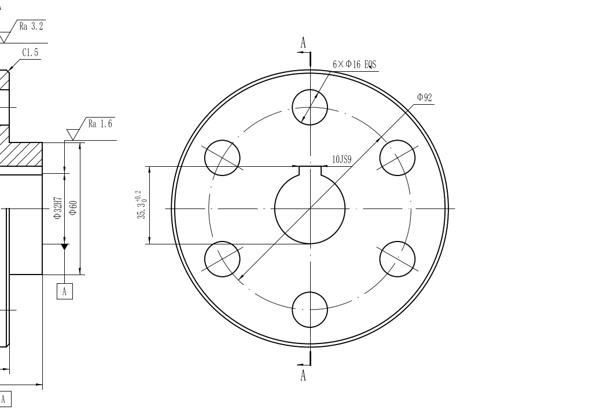
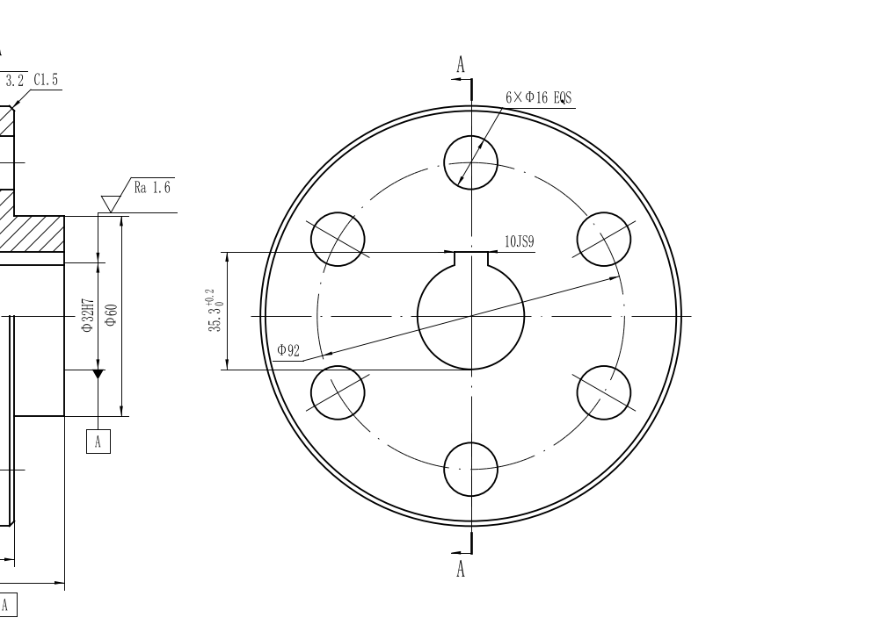

# D1 放射状直径 / 半径引线的候选生成与代价函数

2026-11-21 · issue #83 · 分支 `m5/d1-radial-leader` · 热点 `layout.py`

## 改了什么

入口仍是 `layout.py` 的候选生成与代价函数（DESIGN §4.6：确定性语义放置 + 局部外推 + 冲突报告，不做全局求解）。

1. **候选**：圆形视图的直径 / 半径引线，在原有 8 个习惯方向之外补足 15° 档共 **24 个方向**（0°–345°），每种方向再试 6 种引线长度（约 144 个候选；写死 `at` 时只试长度）。备选方向排在原有方向的全部长度之后——只有习惯方向排不干净时才换方向；写明的 `at` 仍然固定。
2. **代价**（字典序）：文字/图元重叠 → 与其它标注交叉 → 与其它图线共线重合（GB/T 4458.4「尺寸线不与其他图线重合」）→ 与非同心轮廓线交叉。同心圆的直径/半径在公共圆心汇聚、以及与标注圆同心的圆/圆弧属固有交叉，不计；对 Circle / Arc 用解析求交（不是折线近似），避免割线恰好过折线顶点时漏计；交叉对象写进 reason；圆心豁免校验「对方也是同心圆尺寸」（只登记圆尺寸，线性尺寸不在其列）。
3. **避不开的冲突**：照画，并把 `crossings` / `violations`（with + kind：overlap / cross / coincide / outline）/ `corridors`（文字框四向余量）写进 `placement.resolved`，reason 追加「不可避免的交叉：…」（DESIGN §4.6.3 的过渡形态；warn finding 由 E2 的规则卡承接，见 PR）。
4. **放置顺序**：写死 `at` + `length` 的 PMI（基准/形位公差/粗糙度）按 §4.6.2 进固定首批；若其候选在当前障碍下没有一个能无冲突落位，则退回「自动线性尺寸之后、圆形引线之前」的早批（不硬占位），挂在尚未放置的自动圆形尺寸上的 PMI 仍后置。确定性、固定元素不动都有回归用例。

## E5 数字（合并 E5 #119 后在本分支运行）

命令：`uv run python evals/place_scores.py --eval40`（五范例）与 `uv run python evals/run.py --baseline evals/baseline.json`（40 例门禁）。

| 项 | E5 合并时（before） | D1 后（本分支 after） |
|---|---|---|
| flange D.place | 1.0（0/43） | **1.0（0/43）** |
| pulley D.place | 0.9512（4/82） | **0.9512（4/82）** |
| gear_cover D.place | 0.9753（2/81） | **0.9753（2/81）** |
| jack D.place / A.place | 1.0（0/30）/ 1.0（0/23） | **1.0 / 1.0** |
| vise D.place / A.place | 0.9167（2/24）/ 1.0（0/57） | **0.9167 / 1.0** |
| 40 例 D 族分数 | 0.972252（77/2775） | **0.972252（77/2775）** |
| 40 例 A 族 / G / T | null / 1.0 / 1.0 | **null / 1.0 / 1.0** |
| 40 例 geometry / completeness | 1.0（35 例）/ 1.0（5 例） | **1.0 / 1.0** |
| `run.py --baseline` 回归项 | — | **`regressions: []`**（exit 0） |

**为什么 E5 数字不变（不是退化）**：E5 的 `place_dim_cross` / `place_dim_outline` / `place_nesting` / `place_row_spacing` 按设计只判 **frame 型（线性 / 对齐）尺寸**；`_leader_dim()` 明确把圆形直径 / 半径这类引线型尺寸排除，引线型尺寸的尺寸界线由 `place_ext_line` 治理（不判与其他尺寸线的交叉）。D1 改的正是引线型圆尺寸，所以五范例与 40 例 D 族数字与 E5 合并时一致；本卡收益体现在本机计数与渲染上（见下），D2 修线性 / 多层尺寸时会直接反映到 E5 的交叉、间距、嵌套子项。

补充（本机计数，同一 45 用例；口径见各节）：自动圆形引线与其它尺寸线交叉 1→0、与非同心轮廓线交叉 8→3（3 个穷举 24 方向 × 6 长度后不可避免，见下表）、共线重合 0→0；有交叉的自动圆形引线 9→3；写死 `at` 0 改动。自动角度变化 8 处（L1/drill_blind_4x10 D.dh/D.pcd、drill_blind_6x8 D.dh/D.pcd、section_aligned_3x12 D.dh、L2/box/bearing_seat D.dh、gearbox_base D.dh、L2/disc/gear_blank D.pcd），明细见 PR 正文。

## 前后渲染图（L2/disc/gear_blank 左视图）

- 前： —— Φ92 的尺寸线斜穿键槽深度尺寸 `35.3 +0.2/0` 的尺寸界线
- 后： —— Φ92 换到 195° 引出，不再与键槽尺寸交叉、也不与中心线重合

## 残余的不可避免交叉（23 处；warn finding 由 E2 承接）

固定 `at` 的尺寸按 DESIGN §4.6 不挪角度，只能调引线长度；其余 3 个自动尺寸穷举 24 个方向 × 6 种引线长度后，所有候选都会与轮廓或文字相碰，取交叉最少者照画并记录（`placement.resolved.violations` / `corridors`）。

| 用例 | 尺寸 | 写死 at | 结果角度 | 相交对象 | 类别 |
|---|---|---|---|---|---|
| example/flange | D.holes | 120.0 | 120.0 | E.left.outer.1 | outline |
| example/bearing_support | D.d | 200.0 | 200.0 | E.front.wall_l.1 | outline |
| example/bearing_support | D.dh | 自动 | 150 | E.top.base.4 | outline |
| L2/box/bearing_seat | D.dp | 135.0 | 135.0 | E.top.model.17 | outline |
| L2/box/gear_pump_body | D.Rc2 | 20.0 | 20.0 | E.front.model.3 | outline |
| L2/box/gear_pump_body | D.dh | 45.0 | 45.0 | E.front.model.4 | outline |
| L2/box/gear_pump_body | D.dq | 45.0 | 45.0 | E.left.model.1 | outline |
| L2/box/gear_pump_body | D.dp | 225.0 | 225.0 | D.dq、E.left.model.4 | coincide/outline |
| L2/box/gearbox_base | D.d1 | 135.0 | 135.0 | E.front.model.13、E.front.model.17 | outline |
| L2/box/gearbox_base | D.D1 | 225.0 | 225.0 | E.front.model.4 | outline |
| L2/box/gearbox_base | D.d2 | 45.0 | 45.0 | E.front.model.13、E.front.model.17 | outline |
| L2/box/gearbox_base | D.D2 | 315.0 | 315.0 | E.front.model.4 | outline |
| L2/box/gearbox_base | D.fh | 自动 | 30 | E.top.model.13 | outline |
| L2/box/valve_body | D.Bd | 20.0 | 20.0 | E.top.model.8 | outline |
| L2/box/valve_body | D.bh | 45.0 | 45.0 | E.top.bpcd.1、E.top.model.1 | outline |
| L2/box/valve_body | D.fh | 30.0 | 30.0 | E.left.model.8、E.left.pcd.1 | outline |
| L2/disc/bearing_cap | D.bolt | 120.0 | 120.0 | E.left.outer.1 | outline |
| L2/disc/flange | D.holes | 120.0 | 120.0 | E.left.outer.1 | outline |
| L2/disc/gear_blank | D.lh | 60.0 | 60.0 | E.left.chamfer.1、E.left.outer.1 | outline |
| L2/fork/bearing_support | D.d | 200.0 | 200.0 | E.front.wall_l.1 | outline |
| L2/fork/bearing_support | D.dh | 自动 | 150 | E.top.base.4 | outline |
| L2/fork/clevis | D.dp | 135.0 | 135.0 | E.front.cut.4、E.front.cut.5 | outline |
| L2/fork/link | D.d1 | -50.0 | -50.0 | E.front.web_b.1 | outline |

## 回归用例（`tests/test_layout_radial.py`）

- `test_gear_blank_pcd_leader_stays_clean`：G2，改动前失败（`D.pcd` 与 `D.kd` 交叉、与水平中心线共线），改动后通过。
- `test_written_angles_are_kept`：五个范例写死的 `at` 不被改动。
- `test_auto_radial_leaders_do_not_cut_other_dimensions`：五个范例的自动圆形引线不与其他尺寸线交叉（公共圆心汇聚豁免）。
- `test_unavoidable_crossings_are_reported`：`bearing_support` 的 `D.dh` 残余交叉写进 resolved（violations kinds、corridors 四向）。
- `test_pmi_is_placed_around_the_automatic_radial_leaders` / `test_pmi_on_an_unplaced_dimension_waits_for_it`：PMI 顺序回归（上一版试做时 `bearing_support` 的 Ra 3.2 被挤到与 `D.dh` 文字重叠、`bearing_cap` 的 R.spig 与 DT.A 重叠，现已 0 overlap finding）。
- `test_candidate_directions_cover_the_fifteen_degree_grid`：24 个候选方向覆盖 15° 档（含 210/240/300/330）。
- `test_contour_crossings_are_analytic_for_circles_and_arcs`：解析求交（过折线顶点的割线也检出）；同心圆弧豁免。
- `test_shared_centre_exemption_only_for_circular_dimensions`：公共圆心豁免只对圆尺寸生效（线性尺寸在圆心交叉仍计）。
- `test_space_conflicts_are_reported_on_the_radial_dimension`：只有文字/间距冲突时也写 violations(kind=overlap) + corridors。
- `test_fixed_pmi_is_placed_before_automatic_dimensions`：写死 at/length 的基准先于自动线性尺寸就位。
- `test_radial_layout_is_deterministic`：同输入两次布局图元与 resolved 完全一致。

## E5 接入结果

已在 `git merge origin/main`（E5 #119，main 242d480）后运行：五范例 `place_scores.py --eval40`、40 例 `evals/run.py --baseline evals/baseline.json`（regressions: []）、以及 `tests/test_examples.py` 与 `tests/acceptance/test_rounds.py` 的冻结 PLACEMENT_DEBT 表。

- 冻结表**未改动**：D1 的改动全在引线型圆尺寸（E5 的 frame 规则不判），五范例与 edit-round 范例的 placement debt 集合与 E5 冻结值逐项相同，两套测试原样通过；没有新增债务项，也没有可收缩项。D2 修线性 / 多层尺寸时将按机制在同一 PR 有意更新这两张表。
- 本文件不再保留"待 E5"占位；合并门禁以 lead 终验（亲跑 `--baseline` + `place_scores`）为准。
