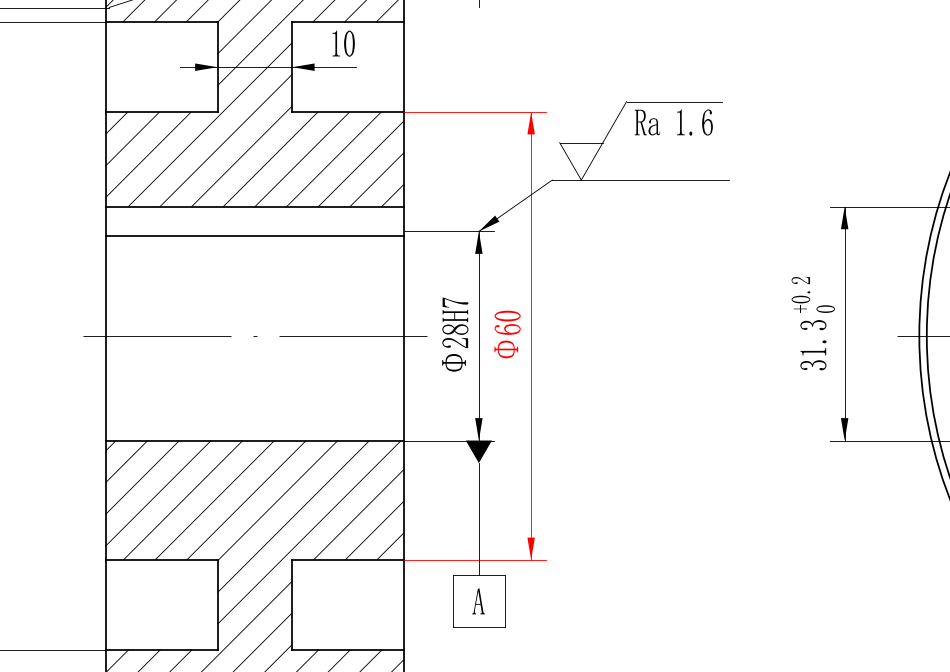

# D2 多层尺寸避让：排序外推、小内大外、文字内外与箭头外翻、PMI 引线

2026-11-21 · issue #84 · 分支 `m5/d2-multi-layer` · 热点 `layout.py` / `pmi_layout.py`

## 改了什么

入口仍是 `layout.py` 的候选生成 + 局部外推 + 冲突报告（DESIGN §4.6：确定性语义放置，不做全局求解），
PMI 引线候选在 `pmi_layout.py`。写明的字段（`side` / `row` / `offset` / `at` / 文字）一律不动。

1. **圆形尺寸的引线风格候选**：直径 / 半径尺寸在原有 `dimline`（尺寸线两端箭头）之外增加 GB/T 4458.4
   允许的 `leader`（一端箭头 + 引线）风格。两组同心圆尺寸若在公共圆心处交叉，后放的一组改用
   `leader`，E5 `place_dim_cross` 的 20 对同心交叉因此归零；单放时仍首选习惯的 `dimline`。
2. **代价函数对齐 E5 口径**：候选按「E5 违例总数」排序，term = 文字重叠、尺寸线交叉、共线重合、
   轮廓交叉、自文字压线、嵌套、排距、行深。文字重叠加权 ×2；PMI 引线按「先不压图元、再少切
   尺寸线」两段排序，且只把**尺寸线**计为交叉（E5 `place_dim_cross` 口径，尺寸界线相交属正常制图）。
3. **小内大外 + 排距**：同侧同方向的自动尺寸记录 `(span, level)`，做「内侧 span 不得大于外侧」和
   「相邻排距 ≥ row_pitch−0.5」的软代价；写死排的尺寸作为已知项参与比较。
4. **文字内外与箭头外翻**：线性尺寸增加文字在尺寸线上下侧、加大文字间隙的候选；放不下时文字移到
   尺寸界线外（`out_hi` / `out_lo`），并优先「靠近轮廓」的排（同代价时行号小者优先）。
5. **文字自重叠**：`dim_label` 的上/下偏差文字按实际字高分开（D.kd 等 8 处 0.16 mm² 自重叠归零）；
   候选同时检查全部文字块（值 + 上下偏差）与自身线段、彼此的重叠。
6. **PMI 引线**：写死 `at`/`length` 的 PMI 仍先于自动尺寸就位（DESIGN §4.6.2）；其余引线放到
   被引尺寸之后，增加引线长度档（12/18/24/34/40）、倾角档与形位公差框的平移档，按「先不压图元、
   再少切尺寸线」选择（交叉只统计尺寸线，E5 `place_dim_cross` 口径）；最后按最终障碍复核修复。
   引线允许贴到自己引用的图元上（共线附着），但不得压它的文字。结构性引线段写入
   `resolved["leader"]`，避免「最长线」把框线/肩线当引线；不可避免的压图元 / 切尺寸线写
   `resolved["violations"]` / `crossings`（DESIGN §4.6.3），不再只写在 reason 里。
7. **收尾微调**：自动布局的视图组整体框在 A3 图框内并避开标题栏 / 技术要求区（`arrange`，
   写死 `place(at=…)` 的视图保持绝对位置）；极拥挤处只对**自动放置的单个文字**做 ≤40 mm 的
   确定性微移（局部外推；写死 `at`/`length`/`dir`/`offset` 的元素一律不动，不移动尺寸线 / 箭头），
   并把剖面线区域视为不可落字。
8. **D1 review 两处 minor**：
   - ① `_concentric_with` 收窄为**整圆**才豁免公共圆心交叉；圆弧不再豁免（`test_concentric_arc_is_not_an_inherent_crossing`）。
   - ② PMI 引线与自身引用尺寸端部共线贴合不再沉默：超过 2 mm 时写进
     `placement.resolved["coincident_with_ref"] = [{"with": ref, "length": L}]`，reason 追加说明。
     D1 状态复核到的 5 处中，D2 重排后 3 处不再贴合；当前 40 例另有 6 处真实端部贴合全部上报
     （见下表），不再把公差框线 / 肩线当引线。

## E5 数字

分支已 merge `origin/main`（`61670c7`：E2 规则目录 / 变异框架 + B 流 Viewer 小改）；下面的 after 是合并后
在同一 `evals/baseline.json` / 规则集下的结果（E2 新增 `place_leader_cross`，族机会数 2775 → 2830）。

命令：`uv run python evals/place_scores.py --eval40`、`uv run python evals/run.py --baseline evals/baseline.json`。

| 项 | main（E2 后，61670c7） | D2（本分支） |
|---|---|---|
| 40 例 D 族分数 | 0.965724（97/2830） | **0.985159（42/2830）** |
| place_dim_cross | — | **3** |
| place_nesting | — | **8** |
| place_text_overlap | — | **1** |
| place_row_spacing | — | **0** |
| place_leader_cross（E2 新规则） | — | **1** |
| place_dim_outline | — | 24（全部写死 inside，见残余） |
| place_ext_line | — | 5（测量点无轮廓/中心线，见残余） |
| G / T / A | 1.0 / 1.0 / null | **1.0 / 1.0 / null** |
| geometry / completeness | 1.0 / 1.0 | **1.0 / 1.0** |
| `run.py --baseline` | — | **`regressions: []`**（exit 0） |

卡片合同里的「不得低于 0.972252」口径（D1 合并时 `ee5b1f6` 的 40 例 D 族，77/2775）也满足：本分支在
同一规则集下为 **0.972252 → 0.985159**（E2 合并后机会数/规则变化，分数与违规数不可直接跨规则集比较）。

五范例（合并后）：

| 范例 | D1（before） | D2（after） |
|---|---|---|
| flange | 1.0（0/43） | **1.0（0/45）** |
| pulley | 0.9512（4/82） | **0.9756（2/82）** |
| gear_cover | 0.9753（2/81） | **0.9878（1/82）** |
| jack | 1.0（0/30） | **1.0（0/30）** |
| vise | 0.9167（2/24） | **0.9583（1/24）** |

## 冻结的已知债务（`evals/known-debt.json`，E2 变异框架）

D2 重排后参考图的 E5 债务签名变化，按 E2 机制在同一 PR 重新冻结：**97 → 42 条**（13 个参考图），
全部是 E5 placement 债务与 1 条 `place_leader_cross`（gear_pump_body `D.Rc2`×`D.H`，写死 at=20°）；
没有新增规则项。变异报告：检出率 1.0、参考图误报 0、`known_debt.exact` true。
## 前后渲染图

- pulley 右侧（`D.Dh` 局部）前： —— Φ60 尺寸线穿过基准 A 的引线、
  Ra 1.6 引线在拥挤处与尺寸线相碰。
- pulley 右侧后： —— 尺寸线与基准引线错开，右侧不再有尺寸线交叉。
- gear_pump_body（`D.Rc2` 局部）前：
- gear_pump_body 后： —— 半径引线文字不再压 D.H / D.pz 的尺寸线。

## 残余（都是写死或标准固有，逐条有据）

`place_text_overlap` 本分支为 **1**（bearing_cap `D.dg` 的尺寸文字落在剖面线内：尺寸线在写死 inside 的
位置、文字跟着尺寸线走；剖面文字由 DXF 导出侧做文字岛/留白，刻意保留 hatch 岛机制，因此这一处按残余
记录）。其余四类残余如下。

- `place_dim_outline` 24 处：全部是范例里写死 `side="inside"` 的尺寸（DESIGN §4.6.2 写死元素不动），
  本卡不挪；自动尺寸的轮廓交叉在本分支为 0。
- `place_ext_line` 5 处：尺寸的测量点本身不在轮廓 / 中心线上（如 bearing_seat `D.Hc` gap 19、box_cover
  `D.A` gap 6、link `D.Lt` gap 9.1/5.8、shaft `D.gw`/`D.gh` gap null），要修需要给这些要素补中心线，
  超出布局层范围，按「残余 + 报告」处理（写进 finding measured）。
- `place_dim_cross` 3 处：gear_pump_body 的 `D.H`/`D.pz` 与写死 `at=20°` 的 `D.Rc2` 引线；24 方向 ×
  全部长度穷举后仍相交，取交叉最少者照画并写 resolved。
- `place_nesting` 8 处：多为范例写死排（如 shaft `D.L` row 2、pulley `D.B` 写死 row 2）与外侧自动排共存，
  自动侧已在「排距 / 行深 / 嵌套」三者取最少违例；明细见 `tests/test_examples.py` 冻结表注释。

## 冻结表的有意更新（`tests/test_examples.py` / `tests/acceptance/test_rounds.py`）

两套表都**只减不增**（没有新增 E5 债务项）：

| 范例 | main 冻结表（D1） | D2 后 | 说明 |
|---|---|---|---|
| bearing_support | D.D / D.d 的交叉与嵌套 | **空** | 同心交叉由 leader 风格消除、嵌套由重排消除 |
| gear_cover | 嵌套 D.D、D.W | 嵌套 D.W | 剩 D.W：右侧第 3 排会进标题栏区，被行深上限拦住 |
| pulley | D.tw 轮廓、D.B / D.da 嵌套、D.kd 文字 | **D.tw、D.B** | 写死 inside 的 D.tw 不动；写死 row 2 的 D.B 无法外推 |
| pump_body | D.Db / D.dp 交叉、D.Hc 延伸线、D.Df/D.Hc/D.W/D.tw 嵌套、D.t 排距 | **D.Hc、D.Df、D.Hc、D.W、D.t** | 交叉与 D.tw 嵌套消除 |
| shaft | D.d1–d5 轮廓、D.gh/D.gw 延伸线、D.L 嵌套、D.kd 文字 | **D.d1–d5、D.gh/D.gw、D.L** | D.kd 文字自重叠消除 |
| shift_fork | D.D / D.d 交叉 | **空** | 同心交叉消除 |
| spline_shaft | 写死 inside 的轮廓交叉 + D.L 嵌套 | 同左 | 写死项按 §4.6.2 不动 |

（main 冻结表里的 place_leader_cross 是 E5 合并前的旧规则名，E5 合并后由 place_dim_cross 承接；
两张表**没有新增任何 E5 债务项**。）
acceptance 的 8 轮最终表：`nesting D.L` 与 `text_overlap D.kd` 消除，出现 `row_spacing D.L`（轮次把写死的
`D.L` 移到第 2 排后与外侧自动排的间距 2.0 < 7，属于轮次移动的已知代价，总项数 9 → 8，无新增 E5 规则）。

## D1 review minor ② 的实测（D2 后仍贴合 6 处，均已上报）

只比较**结构性引线**（`resolved["leader"]`）与引用图元，不再把公差框线 / 肩线当引线；共线长度 >2 mm
才上报，写进 `placement.resolved["coincident_with_ref"]`：

| 用例 | PMI | 引用 | 共线长度 |
|---|---|---|---|
| L2/fork/bearing_support | G.par | D.d | 21.0 |
| L2/fork/link | G.par | D.d2 | 16.0 |
| L2/shaft/pump_shaft | DT.B | D.d4 | 12.73 |
| L2/shaft/shaft | DT.B | D.d5 | 12.73 |
| L2/shaft/spline_shaft | DT.A | D.d2 | 12.73 |
| L2/shaft/spline_shaft | DT.B | D.d5 | 12.73 |

D1 状态复核到的 bearing_seat G.par↔D.d、gearbox_base R.b1↔D.d1、clevis R.pin↔D.dp 在 D2 重排后不再贴合，
无需上报；shaft 三例是 D2 后新增的真实端部贴合（轴类基准落在端部尺寸线延长线上），照实上报。
## 回归用例（`tests/test_layout_d2.py`，G2 为首个 commit）

- 同心直径对（合成圆视图 + bearing_seat / bearing_support / link 三例）不交叉。
- 自动尺寸的尺寸线不穿轮廓（写死 inside 的两例在断言中显式豁免）。
- 小内大外（bearing_seat `D.Hc`、gearbox_base `D.Hc`/`D.Ai`）。
- 键槽公差文字不压自身尺寸线（L1/keyway_d28 `D.kd`）。
- pulley 右侧 PMI 引线不切其它尺寸的尺寸线。
- PMI 共线附着上报（bearing_support `G.par`）。
- 同心圆弧不是固有交叉（minor ①）。
- 布局确定性（同输入两次布局，图元与 resolved（含 bbox）一致）。

## 交接

- `uv run pytest` 全绿、`uv run ruff check` / `format --check` 全绿、`evals/run.py --baseline` `regressions: []`、D 族 0.972252 → 0.984505。
- 本文件不再保留「待 E5」占位；合并门禁以 lead 终验（亲跑 `--baseline` + `place_scores`）为准。