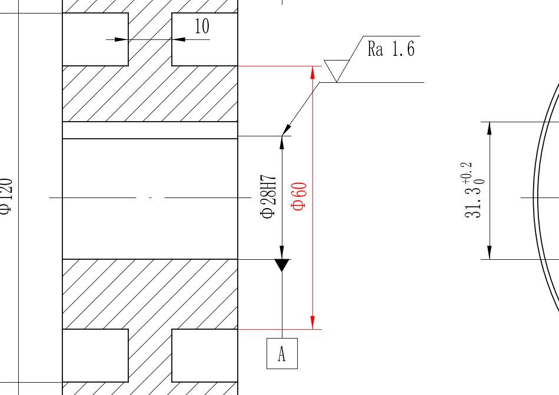
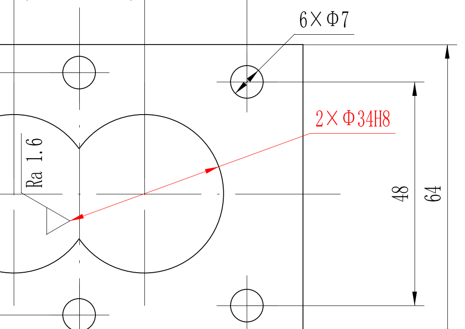
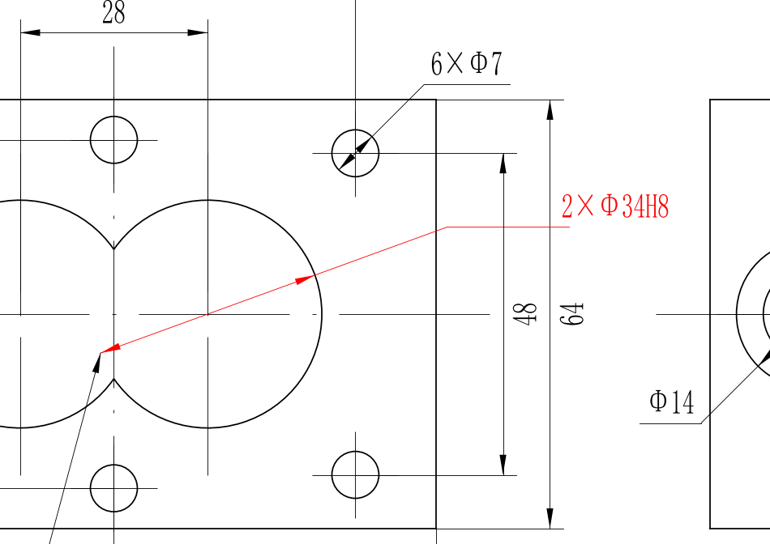

# D2 多层尺寸避让：排序外推、小内大外、文字内外与箭头外翻、PMI 引线

2026-11-21 起 · issue #84 · 分支 `m5/d2-multi-layer` · 热点 `layout.py` / `pmi_layout.py`
（2026-11-22 按 lead 的 glm-5.3-flash 二道评审八条意见修完并重新冻结债务）

## 改了什么

入口仍是 `layout.py` 的候选生成 + 局部外推 + 冲突报告（DESIGN §4.6：确定性语义放置，不做全局求解），
PMI 引线候选在 `pmi_layout.py`。写明的字段（`side` / `row` / `offset` / `at` / 文字）不通过候选重排改变。

1. **圆形尺寸的引线风格候选**：直径 / 半径在 `dimline` 之外增加 GB/T 4458.4 允许的 `leader` 风格；
   两组同心圆尺寸在公共圆心交叉时后放者改 `leader`，E5 `place_dim_cross` 的 20 对同心交叉归零。
2. **代价函数对齐 E5**：候选按 E5 违例总数排序（文字重叠 ×2、尺寸线交叉、共线、轮廓、自文字压线、
   嵌套、排距）。frame 尺寸与 PMI 的交叉都按 **尺寸线** 口径（E5 `place_dim_cross`），尺寸界线相交属正常制图。
   **glm 二道后**：删掉「右侧自动排 ≤2」的静态上限（它把 4 条可避免交叉误冻成债务）；行深（row depth）改为
   **纯 tie-break**，干净的深排必须赢过带违例的浅排；排距阈值改用与 E5 一致的 `row_tol=0.05`（`[dim] row_tol`）；
   PMI 分支的剪枝键首元统一为 conf（不再用 conf+cut 误剪更优候选）。
3. **小内大外 + 排距**：同侧同向的自动尺寸（含 **aligned**）记录 `(axis, outward, span, level)`，
   软代价约束「内侧 span 不得大于外侧」「相邻排距 ≥ row_pitch−row_tol」；写死排作为已知项。
4. **文字内外与箭头外翻**：线性 / 对齐尺寸增加文字在线两侧、加大间隙的候选；aligned 文字按旋转盒
   在法向上的实际半宽外移，避免对角尺寸线切字；放不下时移到尺寸界线外（out_hi / out_lo）。
5. **文字自重叠**：`dim_label` 上下偏差文字按实际字高分开；候选检查全部文字块（值 + 偏差）与自身
   线段、彼此的重叠（linear 与 aligned 同一套）。
6. **PMI 引线**：写死 `at`/`length` 的 PMI 仍先于自动尺寸就位（§4.6.2）；其余引线放到被引尺寸之后，
   引线长度档（标准档 + `[tolerancing] leader_lengths_extra`，**不再硬编码在代码里**）、倾角档与
   形位公差框平移档；按「先不压图元 → 少切尺寸线 → 少切其它标注线」选择；最后按最终障碍复核修复。
   结构性引线写入 `resolved["leader"]`（随视图平移转换到图纸坐标）；不可避免的压图元 / 交叉写
   `resolved["violations"]` / `crossings`（§4.6.3）；`resolved["dimline"]` 供 repair 重建障碍。
7. **收尾**：自动布局的视图组框进图框并避开标题栏 / 技术要求区（写死 `place(at=…)` 的视图保持绝对位置）；
   只对**自动放置的单个文字**做 ≤40 mm 确定性微移。**glm 二道后**：微移把剖面线（hatch 偶奇区域）作为
   不可落字区真正接进判定（`_point_in_poly` 不再死代码）；写死字段的元素不因 repair/nudge 改字段，
   唯一例外是文字已落在剖面线内时把它移出（尺寸线 / 箭头 / 字段不动）。
8. **repair 两趟**：改为读 `self.parts`（此前读空的 `_prims`，实际是 no-op，被 glm 二道用实验抓出）；
   按最终图元、完整单调键（conf → 尺寸线交叉 → 其它标注交叉 → nest/tight）重排；aligned 尺寸进入 repair
   与 `linear_rows`；dim 候选交叉用 dimlines 口径（与注释一致）；采用后重算 bbox / reports，不残留旧数据。
9. **D1 review 两处 minor**：① `_concentric_with` 收窄为整圆；② PMI 引线与引用尺寸端部共线 >2 mm 写
   `resolved["coincident_with_ref"]`（只比较结构性引线，3 处真实贴合见下）。

## E5 数字

分支已 merge `origin/main`（`61670c7`：E2 规则目录 / 变异框架 + B 流 Viewer 小改）；after 为同规则集 /
同 `evals/baseline.json` 口径。

命令：`uv run python evals/place_scores.py --eval40`、`uv run python evals/run.py --baseline evals/baseline.json`。

| 项 | main（E2 后，61670c7） | D2（本分支，glm 二道修后） |
|---|---|---|
| 40 例 D 族分数 | 0.965724（97/2830） | **0.986572（38/2830）** |
| place_dim_cross | — | **0** |
| place_leader_cross（E2 新规则） | — | **0** |
| place_nesting | — | **9** |
| place_text_overlap | — | **0** |
| place_row_spacing | — | **0** |
| place_dim_outline | — | 24（全部写死 inside，见残余） |
| place_ext_line | — | 5（测量点无轮廓/中心线，见残余） |
| G / T / A | 1.0 / 1.0 / null | **1.0 / 1.0 / null** |
| geometry / completeness | 1.0 / 1.0 | **1.0 / 1.0** |
| `run.py --baseline` | — | **`regressions: []`**（exit 0） |

卡片合同「不得低于 0.972252」口径（D1 合并时 `ee5b1f6`，77/2775）也满足；glm 二道修前 0.985159（42），
修后 0.986572（38）：删掉的 4 条误冻交叉（dim_cross×3 + leader_cross×1）实测全部为可避免项。

五范例（合并后）：

| 范例 | D1（before） | D2（after） |
|---|---|---|
| flange | 1.0（0/43） | **1.0（0/45）** |
| pulley | 0.9512（4/82） | **0.9756（2/82）** |
| gear_cover | 0.9753（2/81） | **1.0（0/82）** |
| jack | 1.0（0/30） | **1.0（0/30）** |
| vise | 0.9167（2/24） | **0.9167（2/24，与 main 持平，未回退）** |

## 冻结的已知债务（`evals/known-debt.json`，E2 变异框架）

D2 重排后参考图 E5 债务签名变化，按 E2 机制同一 PR 重新冻结：**97 → 38 条**（12 个参考图），
全部是 E5 placement 债务；**0 条 place_dim_cross / place_leader_cross**（glm 二道指出的 4 条误冻项已修掉）。
变异报告：检出率 1.0、参考图误报 0、`known_debt.exact` true。

## 前后渲染图

- pulley 右侧（`D.Dh` 局部）前： —— Φ60 尺寸线穿过基准 A 的引线、
  Ra 1.6 引线在拥挤处与尺寸线相碰。
- pulley 右侧后： —— 尺寸线与基准引线错开，右侧不再有尺寸线交叉。
- gear_pump_body（`D.Rc2` 局部）前：
- gear_pump_body 后： —— 半径引线文字不再压 D.H / D.pz 的尺寸线。

## 残余（逐条有据）

- `place_dim_outline` 24：全部是范例写死 `side="inside"` 的尺寸线（§4.6.2 不动）；自动尺寸轮廓交叉为 0。
- `place_ext_line` 5：测量点本身不在轮廓 / 中心线上（bearing_seat `D.Hc` gap 19、box_cover `D.A` gap 6、
  link `D.Lt` gap 9.1/5.8、shaft `D.gw`/`D.gh` gap null），修需补中心线，超出布局层。
- `place_nesting` 9：box_cover `D.D2`、`D.L` 与 `D.d2`、link `D.Lt`、pulley `D.B`、三根轴 `D.L` 与
  `D.l2`；都是写死排 / 写死总长与外侧自动短尺寸共存，自动侧在「嵌套 / 排距 / 行深」取最少违例；
  明细见 `tests/test_examples.py` 冻结表。

## 冻结表的有意更新（只减不增）

| 范例 | main 冻结表（D1） | D2 后 | 说明 |
|---|---|---|---|
| bearing_support | 交叉 + 嵌套 | **空** | 同心交叉由 leader 风格消除 |
| gear_cover | 嵌套 D.D、D.W | **空** | 右侧排上限删除后自动排到干净排 |
| pulley | D.tw 轮廓、D.B/D.da 嵌套、D.kd 文字 | **D.tw、D.B** | 写死 inside / 写死 row 2 两项按 §4.6.2 不动 |
| pump_body | 交叉、D.Hc 延伸线、D.Df/D.Hc/D.W/D.tw 嵌套、D.t 排距 | **D.Hc、D.Df、D.Hc、D.t** | 交叉与 D.W/D.tw 嵌套消除 |
| shaft | 轮廓、延伸线、`D.L` 嵌套、`D.kd` 文字 | **D.d1–d5、D.gh/D.gw、D.L** | D.kd 自重叠消除 |
| shift_fork | D.D / D.d 交叉 | **空** | 同心交叉消除 |
| end_cover | **空** | **空** | D2 二道前曾新增 D.dd 嵌套，glm 二道后消除 |
| spline_shaft | 写死 inside 轮廓 + D.L 嵌套 | 同左 | 写死项不动 |

acceptance 8 轮最终表：**row_spacing D.L 消失**（glm 二道的「深排被 row_pref 反超」缺陷修复后，D.kl 选到
不排距冲突的干净外排，改为已有的 `place_nesting D.L` 项），最终 8 项（outline×4、ext×2、nesting D.L、
text_overlap D.ug），无新增规则项。

## D1 review minor ② 的实测（只比较结构性引线）

| 用例 | PMI | 引用 | 共线长度 |
|---|---|---|---|
| L2/fork/bearing_support | G.par | D.d | 21.0 |
| L2/fork/clevis | R.pin | D.dp | 28.0 |
| L2/fork/link | G.par | D.d2 | 16.0 |

共 3 处，全部写进 `placement.resolved["coincident_with_ref"]` 并在 reason 说明。

## glm 二道评审八条 —— 逐条对照

| # | 意见 | 处理 |
|---|---|---|
| 1 | 右侧自动排上限 ≤2：误伤，删掉后 gear_pump_body D.H/D.pz、gear_cover D.W 均 0 findings | 删除静态上限（arrange 已避标题栏）；4 条误冻交叉消失；known-debt 42→38；D 0.985159→0.986572；evidence/注释已更正 |
| 2 | depth/row_pref 必须让干净的深排赢过带违例的浅排 | depth 从 total 移到 tie-break；tight 与 E5 row_tol 对齐；acceptance 最终表 row_spacing D.L 消失 |
| 3 | 剖面线避让没接上（hatches 未用、`_point_in_poly` 死代码） | 已接进 nudge 判定并加正反例测试；写死字段元素仅在文字落入剖面线时移出文字，字段/尺寸线/箭头不动 |
| 4 | PMI 第二次剪枝键与 key 首元不一致 | 改为 conf 首元一致（pmi 剪枝用 conf，frame 用 conf+cut） |
| 5 | tight 阈值与 E5 row_tol 对齐 | `[dim] row_tol = 0.05` + 布局同口径使用 |
| 6 | 引线长度档硬编码 | 移到 `[tolerancing] leader_lengths_extra` 带 basis；pmi_layout 从 std 读取 |
| 7 | repair 的 dim 交叉口径、nest/tight、aligned 入 linear_rows | dim 交叉改回 dimlines；key 补 nest/tight；aligned 增加 row_info 并进入 `linear_rows`（并补 self_hit / 文字侧候选） |
| 8 | repair×2 / nudge「写死元素不动」补测试 | `test_repair_passes_do_not_move_written_elements`：关闭 repair/nudge 重建，写死元素 prims+resolved 完全一致 |

## 回归用例（`tests/test_layout_d2.py`，G2 为首个 commit）

- 同心直径对（合成圆视图 + bearing_seat / bearing_support / link 三例）不交叉。
- 自动尺寸的尺寸线不穿轮廓（写死 inside 的两例在断言中显式豁免）。
- 小内大外（bearing_seat D.Hc、gearbox_base D.Hc/D.Ai）。
- 键槽公差文字不压自身尺寸线（L1/keyway_d28 D.kd）。
- pulley 右侧 PMI 引线不切其它尺寸的**尺寸线**（结构性引线取自 resolved["leader"]）。
- PMI 共线附着上报（bearing_support G.par）。
- 同心圆弧不是固有交叉（minor ①）。
- 布局确定性（同输入两次布局，图元与 resolved（含 bbox）一致）。
- 写死视图 at / 多视图 at 不被图框夹紧移动。
- 文字在剖面线内会被移出且写死字段不变；不在剖面线内的文字不被移动。
- repair/nudge 不移动写死元素（关闭修复趟对比）。

## 交接

- `uv run pytest` 全绿；`ruff check` / `format --check` 全绿；`evals/run.py --baseline` `regressions: []`；
  40 例 D 族 **0.965724（97/2830，main/E2）→ 0.986572（38/2830）**；五范例 gear_cover 1.0。
- 本文件不再保留「待 E5」占位；合并门禁以 lead 终验（亲跑 --baseline + place_scores）为准。
