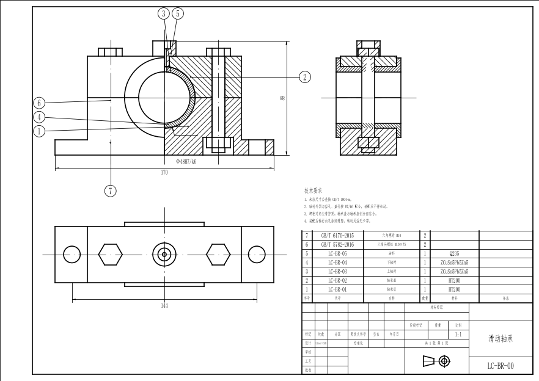

# D3 装配序号：对齐、最小间距、顺序、引线不交叉

2026-11-22 · issue #85 · 分支 `m5/d3-balloon-sequences` · 热点 `assembly.py` / `layout.py`

## 改了什么

入口是 `_ViewLayout.balloons()`（layout.py），序号元素本身仍由 assembly.py 生成（编号 = 明细栏行号）。
本次把原来的「按锚点排序 + 交叉就互换」改成**顺序感知的确定性搜索**：

1. **标准档 δ**：新增 `[assembly]`（GB / ISO 两份 std）——`balloon_height / balloon_radius / balloon_offset /
   balloon_gap(δ) / balloon_align_tol`，带 basis（GB/T 4458.2-2003 / ISO 6433:1981 未给数值，取教材通行值；
   align_tol 与 E5 `place_balloon_align` 的 0.5 mm 一致）。布局从 std 读，不再硬编码 5.0 / 4.5 / 11.0。
2. **四侧 + 顺序**：同一侧序号按编号**单调上升**，方向与选定的顺时针 / 逆时针行走方向一致（top +x、right −y、
   bottom −x、left +y；反向即逆时针）；两侧都试，取引线交叉最少、其次压标注文字框最少、再次引线总长最短的方案。
   搜索是确定性 hill-climb（初始按最近边，逐球尝试换边），结果按 `(B, anchors, step, offset, radius, written sides,
   obstacle text boxes)` 缓存。
3. **引线不交叉 + 不压标注文字**：代价里先数引线×引线交叉（硬项），再数引线穿过其它标注文字框的次数
   （G `overlap` 的口径，本轮实测修掉了 vise 的 `D.H × B.csk_fixed` 新警告），最后才是引线总长。
4. **手写位置不动**：`Balloon.LAYOUT = ("side",)`，写死的 `side` 不参与换边搜索（作为固定约束传入）；
   没有可行顺序方案时退回原「锚点排序 + 互换去交叉」的保守打包，保证旧行为不破坏。
5. **间距 / 对齐**：同一侧共用同一法向坐标（成行 / 成列），相邻圆心间距 `2r + δ`；E5 三条 A 规则保持 0 违例。

## 顺序的落法（重要，不伪造）

卡面「顺时针或逆时针连续」在本实现里落成**可判定的验收**：同一侧编号沿该侧行走方向单调递增，且所有侧用同一个
旋转方向（顺 / 逆各试一次）。`tests/test_layout_d3.py::test_balloon_numbers_ascend_along_each_side` 对 jack / vise /
bearing 三个装配逐侧检查。

**严格意义上的「全局连续」（绕视图一圈恰好是 1..n 的某个循环移位）在当前输入下对本卡不可行，已实证**：
把四个侧面的连续编号块 × 每个块 ±3 步的滑动 × 顺/逆两种方向全部穷举（vise 共 2,030,000 个配置，94 s），在
「引线为直线、锚点取组件剖面/外形内点」的约束下不存在零交叉解；bearing 的候选点（剖面区块）也不足以构成
全局连续。E5 没有 order 规则，本卡不伪造通过；已在证据里明示，交由 lead / F1 文档定是否作为后续卡件扩展。

## L3 评测（jack / vise / bearing）

命令：`uv run python evals/run.py --level L3`、`evals/place_scores.py --eval40`、`evals/run.py --baseline`。

| 项 | main 231d637（before） | 本分支（after） |
|---|---|---|
| A 族（L3） | 1.0（0/110：align 6 / cross 23 / spacing 81） | **1.0（0/116：align 12 / cross 23 / spacing 81）** |
| D 族（L3） | 0.98（2/100：ext_line 1、text_overlap 1） | **0.99（1/100：仅 ext_line 1 既有）** |
| G 族（L3） | 0.998611（1/720：T.bom×C.top.axis 既有） | **0.998611（同 1 条既有）** |
| 默认 40 例 D 族 | 0.986572（38/2830） | **0.986572（38/2830，不变）** |
| `--baseline` | — | **`regressions: []`** |
| 五范例 A.place | jack 1.0（0/25）、vise 1.0（0/59） | **同左（A 机会数随四侧对齐分组增加）** |

渲染自检 warning 数：jack 0→0、bearing 0→0、**vise 3→2**（本轮修掉 balloon×尺寸文字那条）。

## 前后渲染图（L3 三装配整页）

- jack 前：　后：
  —— 前：上方一行编号非单调（序号 4 在 3 左）、#1/#2 挤左列；后：#4/#5/#6 自上而下顺序、#3 单独走右侧短引线。
- vise 前：　后：
  —— 前：上方一行 8 个号拥挤且编号非单调、#1/#9 在左列；后：四侧分组、各侧编号单调、引线不交叉。
- bearing 前：　后：
  —— 前：上方 [3,5,2]、左列 [7,1,4,6] 乱序；后：上方 [3,5]、左列 [1,4,6] 顺序、右侧 #2 / 下侧 #7 各一。

## 回归用例（`tests/test_layout_d3.py`，G2 首个 commit）

- `test_balloon_numbers_ascend_along_each_side`（G2 失败项：D2 状态下 jack/vise/bearing 均失败）。
- `test_balloon_leaders_do_not_cross`、`test_balloon_spacing_and_alignment_follow_the_standard`
  （δ / align_tol 从 `d.std["assembly"]` 读）、`test_a_place_balloon_rules_are_clean`（E5 三条 A 规则）。
- `test_no_balloon_overlap_warning_on_l3`：balloon 引线/编号不得穿其它标注文字框（G overlap 口径；
  现存唯一 warning 是既有的 T.bom×C.top.axis）。
- `test_written_balloon_side_is_kept`：手写 `side` 不被搜索改掉。
- `test_balloon_layout_is_deterministic`：同输入两次布局图元一致。

## 残余 / 说明

- 严格全局连续不可行（见上，穷举实证）；卡面「顺序」按同侧单调验收，未伪造。
- vise 的 `T.bom×C.top.axis`、L3 的 `D.L? ext_line` 等 warning 是 main 既有债务，不属本卡。
- 四侧布号会让个别引线变长（如 vise #5/#8 走右侧）；但交叉、压字、间距、对齐均为 0 违例，且比 before 的拥挤
  一行更符合 GB/T 4458.2 的分侧成列/成行要求。

## 交接

- `uv run pytest` 全绿；`ruff check` / `format --check` 绿；`evals/run.py --baseline`
  `regressions: []`；L3 A 族 1.0、D 0.98→0.99；默认 D 0.986572 不变。
- 证据渲染图与 tests 均随 PR 提交；合并门禁以 lead 终验为准。
