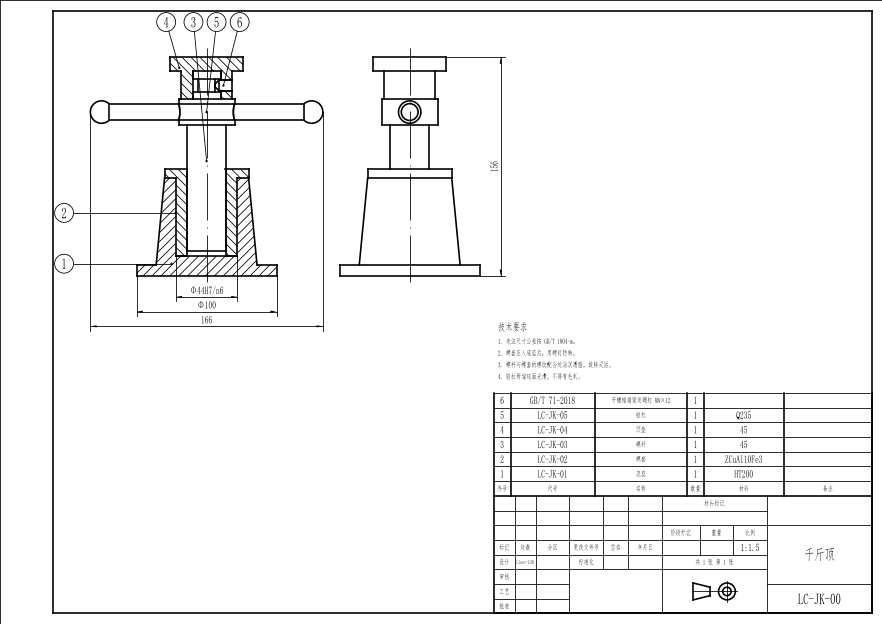
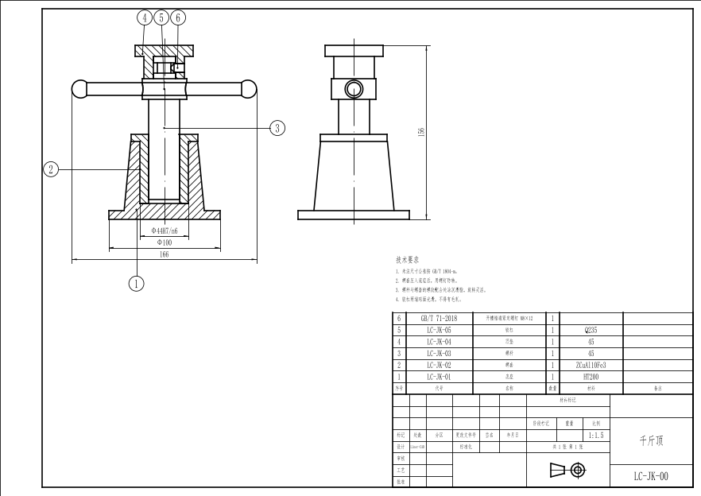
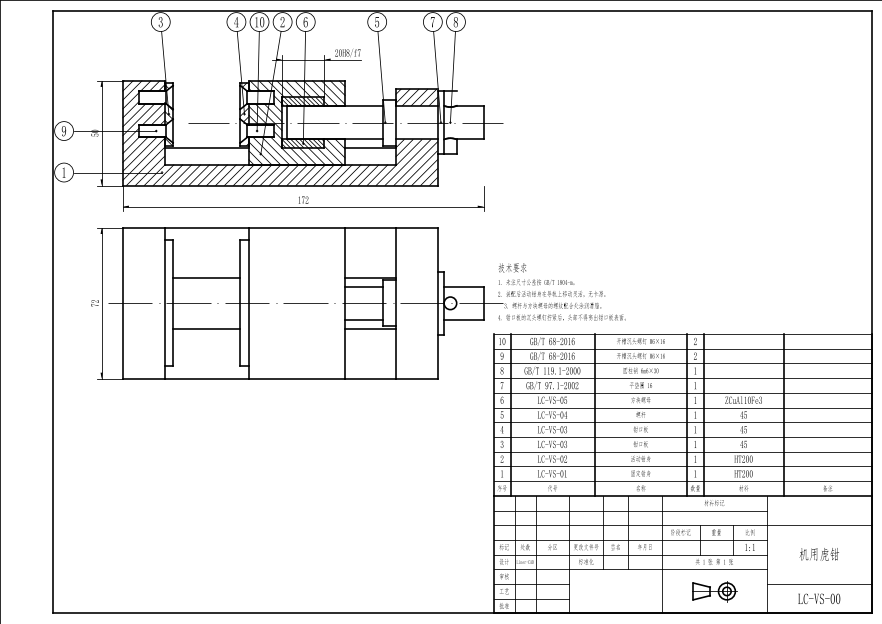
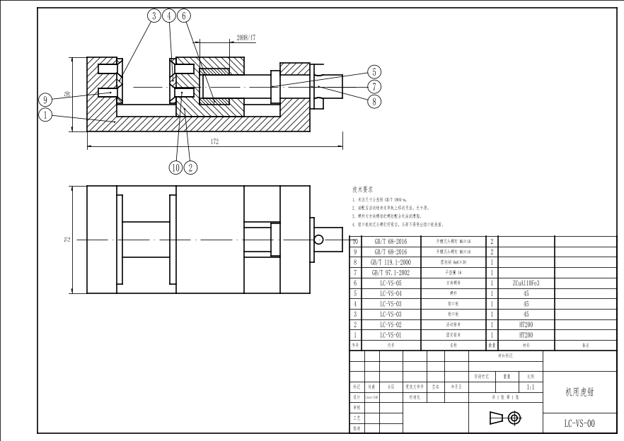
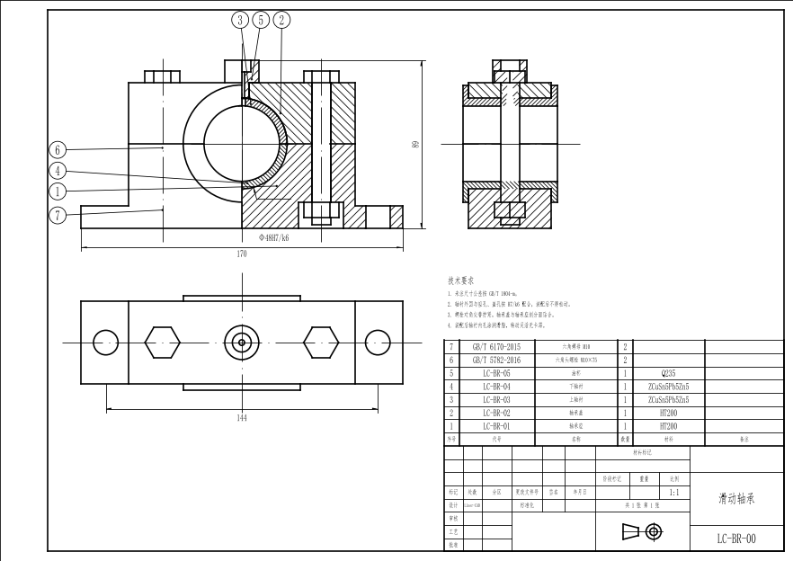

# D3 装配序号：对齐、最小间距、顺序、引线不交叉

2026-11-22 · issue #85 · 分支 `m5/d3-balloon-sequences` · 热点 `layout.py`（assembly.py 的锚点生成未改）

## 口径偏离（lead 裁定 A，PR 正文同步明示）

issue 原文的「顺时针或逆时针连续」在本卡**不能按直线引线字面实现**：对 vise / bearing 做穷举——
四个侧面的连续编号块 × 每块 ±3 步滑动 × 顺/逆两方向，共 **2,030,000 个配置、94 s，零交叉解**；
几何上这两个装配的组件绕视图的环向顺序与编号顺序不一致（组件左右交替），直线引线无法同时满足
「全局连续」与「不相交」，移动锚点也改变不了组件的环向次序。

按 lead 2026-11-22 裁定（B3 先例、不伪造不硬凑），本卡验收口径落为：

> **同一侧序号沿同一旋转方向单调递增（行 / 列形态）+ 对齐 + 间距 ≥ δ + 引线交叉 0**。
> 依据 GB/T 4458.2-2003 对序号排布认可两种形态（沿圆周顺/逆时针连续，或按行 / 列整齐排列），
> 且标准措辞是「尽可能」；本实现是行 / 列口径的强化版（同侧还保持旋转方向单调）。
> 严格全局连续留作 v0.2 候选（折线/绕行引线或改锚点，需要单独标准审查，超出 D3 热点）。

此偏离已由 lead 列入 F1 docs PR 的偏离清单（第 4 条）。证据中的数据与措辞不删减、不粉饰。

## 改了什么

入口是 `_ViewLayout.balloons()`（layout.py），序号元素仍由 assembly.py 生成（编号 = 明细栏行号）。
原来的「按锚点排序 + 交叉互换」改为**顺序感知的确定性搜索**：

1. **标准档**：`[assembly]`（GB / ISO 两份 std）只留圆圈几何：`balloon_height / balloon_radius /
   balloon_offset`（带 basis：GB/T 4458.2-2003 / ISO 6433:1981 未给数值，取教材通行值）。最小间距 δ 与
   对齐容差**单一来源** = `[placement].balloon_clearance / balloon_align_tol`（E5 A.place 同值），
   不再在 [assembly] 复制一份；测试断言两份 std 的 assembly 几何一致、[placement] 两键存在。
2. **四侧 + 顺序**：同一侧按编号升序，方向与旋转方向一致（top +x、right −y、bottom −x、left +y；
   反向即逆时针）；顺/逆都试，先最小化引线交叉、再最小化穿过标注文字框、再最小化引线总长。
   确定性 hill-climb（初始近边、逐球换边），结果按 `(B, anchors, step, offset, radius, written, obstacles)`
   缓存（有界 256 条）。
3. **引线不交叉 + 不压标注文字**：交叉为硬项；穿其它标注文字框按 G `overlap` 口径计数（本轮修掉
   vise 的 `D.H × B.csk_fixed` 新警告）；leader 总长仅作末位 tie-break。
4. **手写位置不动**：`Balloon.LAYOUT = ("side",)`，写死 side 不参与换边；无可行顺序方案时退回原
   「锚点排序 + 互换去交叉」打包，并在 `resolved["order"] = "fallback"` 明示（不静默）；搜索成功时写
   `resolved["order"] = "side-monotonic"`。
5. **跨视图**：视图组 `arrange()` 用包含 balloon 图元的 `full` bbox 排布，组间保留 gap；新增
   「一个序号放到另一个视图后 layout，A.place 三规则仍 0、全局引线不交叉」回归测试（主视图 + 俯视图场景）。

## L3 评测（jack / vise / bearing，当前分支）

命令：`uv run python evals/run.py --level L3`、`evals/place_scores.py --eval40`、`evals/run.py --baseline`。

| 项 | main 231d637（before） | 本分支（after） |
|---|---|---|
| A 族（L3） | 1.0（0/110：align 6 / cross 23 / spacing 81） | **1.0（0/116：align 12 / cross 23 / spacing 81）** |
| D 族（L3） | 0.98（2/100：ext_line 1、text_overlap 1） | **0.99（1/100：仅 ext_line 1 既有）** |
| G 族（L3） | 0.998611（1/720：T.bom×C.top.axis 既有） | **0.998611（同 1 条既有）** |
| 默认 40 例 D 族 | 0.986572（38/2830） | **0.986572（38/2830，不变）** |
| `--baseline` | — | **`regressions: []`** |
| 五范例 A.place | jack 1.0（0/25）、vise 1.0（0/59） | **同左（A 机会数随四侧对齐分组增加）** |

渲染自检 warning：jack 0→0、bearing 0→0、**vise 3→2**（本轮修掉 balloon×尺寸文字那条）。

## 前后渲染图（L3 三装配整页）

- jack 前：　后：
  —— 前：上方一行编号非单调（#4 在 #3 左）、#1/#2 挤左列；后：#4/#5/#6 按旋转方向顺序、#3 短引线走右侧。
- vise 前：　后：
  —— 前：上方一行 8 个号拥挤且编号非单调、#1/#9 在左列；后：四侧分组、各侧编号单调、引线不交叉。
- bearing 前：　后：
  —— 前：上方 [3,5,2]、左列 [7,1,4,6] 乱序；后：上方 [3,5]、左列 [1,4,6] 顺序、右侧 #2 / 下侧 #7 各一。

## 回归用例（`tests/test_layout_d3.py`，G2 首个 commit `b5a66ac`）

- `test_balloon_numbers_ascend_along_each_side`（G2 失败项：D2 状态下 jack/vise/bearing 均失败）。
- `test_balloon_leaders_do_not_cross`、`test_balloon_spacing_and_alignment_follow_the_standard`
  （δ / align_tol 从 `std["placement"]` 读）、`test_a_place_balloon_rules_are_clean`。
- `test_l3_uses_the_order_plan`：L3 三例都走 side-monotonic 方案（不是 fallback）。
- `test_fallback_reports_its_order_state`：强制 plan 不可用时 resolved 标 `fallback` 且 A.place 仍 0。
- `test_no_balloon_overlap_warning_on_l3`：balloon 引线/编号不得穿其它标注文字框（既有 T.bom×C.top.axis 除外）。
- `test_balloons_from_two_views_do_not_collide`：跨视图（front + top）布局后 A.place 0、引线不交叉。
- `test_written_balloon_side_is_kept`、`test_balloon_layout_is_deterministic`（清缓存后重建对比）。
- `tests/test_std.py`：GB/ISO 的 assembly 几何一致、[placement] 是 δ / align_tol 单一来源。

## Codex 第 1 轮评审回应

| 意见 | 处理 |
|---|---|
| blocker：全局连续未实现、测试被改写 | lead 裁定 A（见上「口径偏离」）；PR 正文明示；不伪造；严格连续留 v0.2 |
| major：跨视图避让只在本视图 | arrange 用包含 balloon 的 full bbox 排布；新增跨视图回归测试；证据记录 |
| major：>12 静默 / fallback 破坏顺序 / 声称有偏移搜索 | 结果写 `resolved["order"]`（side-monotonic/fallback）；fallback 路径有测试；>12 走同一 fallback 并明示 |
| major：δ 不是 E5 同源、测试容差 0.25 掩盖 | δ/align_tol 单一来源 = `[placement]`（E5 同值）；测试改为 `>= 2r + δ - 1e-9`；std 测试锁定 |
| minor：std 覆盖、确定性缓存、缓存键、性能、offset 注释 | std 测试补 assembly/placement；确定性测试清缓存；缓存键含障碍框并做 256 条有界；offset 注释改「到圆圈边缘」；全量 pytest 1334 passed / 14m04s |

## 残余 / 说明

- 严格全局连续不可行（2,030,000 组 / 94 s 零解，含脚本方法见上）；按 lead 裁定落为同侧单调口径。
- vise `T.bom×C.top.axis` 与 L3 `place_ext_line` 1 条为 main 既有，不属本卡。
- 四侧布号会让个别引线变长（vise #5/#8 走右侧），但交叉、压字、间距、对齐均 0 违例，且比 before 的拥挤一行
  更符合 GB/T 4458.2 的行 / 列形态要求。
- 折线 / 绕行引线、改组件锚点是 v0.2 候选方向，需要单独标准口径审查。

## 交接

- `uv run pytest` 全绿（1334 passed / 1 skipped，14m04s）；`ruff check` 绿；`ruff format --check src tests` 绿
  （`scripts/release.py` 的格式问题为 main 既有，不属本卡，CI lint 只跑 ruff check）。
- `evals/run.py --baseline` `regressions: []`；L3 A 族 1.0、D 0.98→0.99；默认 D 0.986572 不变。
- 合并门禁以 lead 终验为准；本卡非核心，无 glm 二道。
