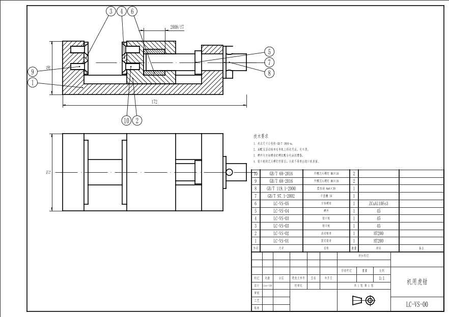
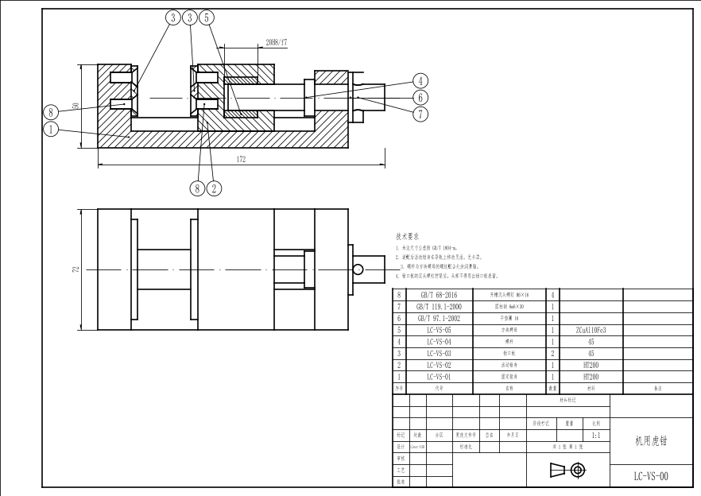
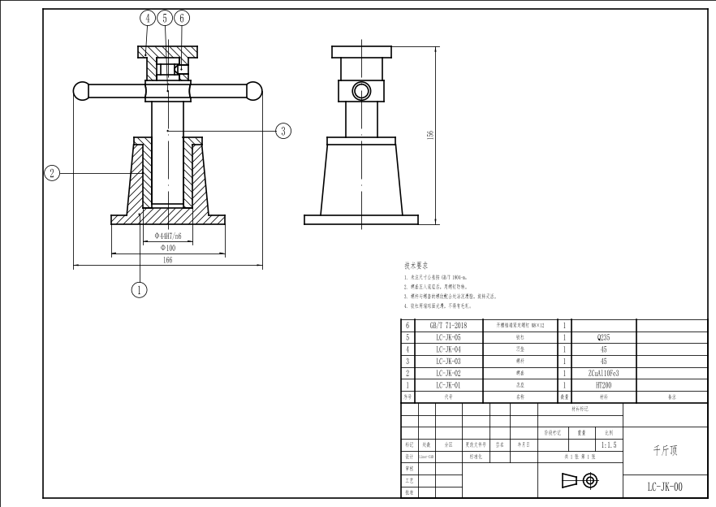
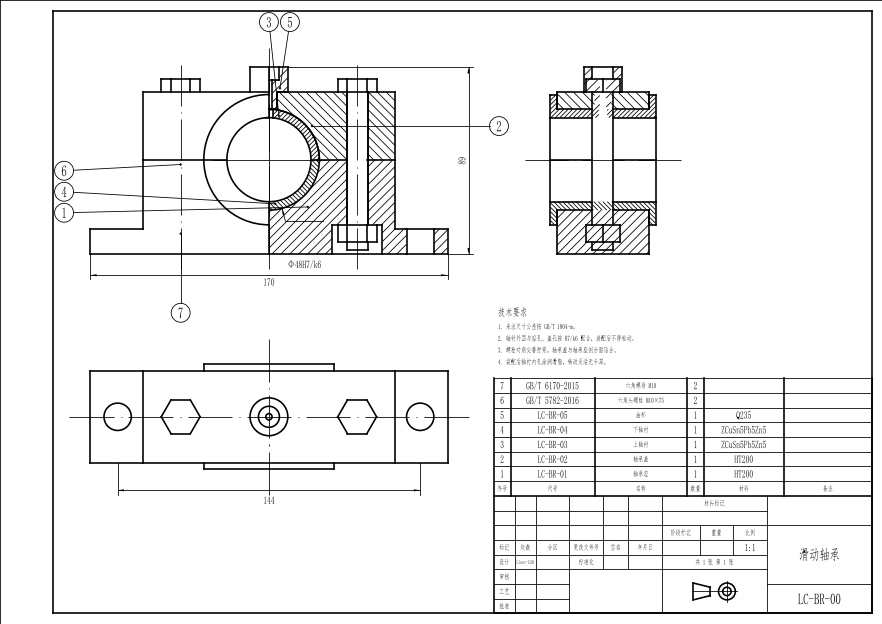
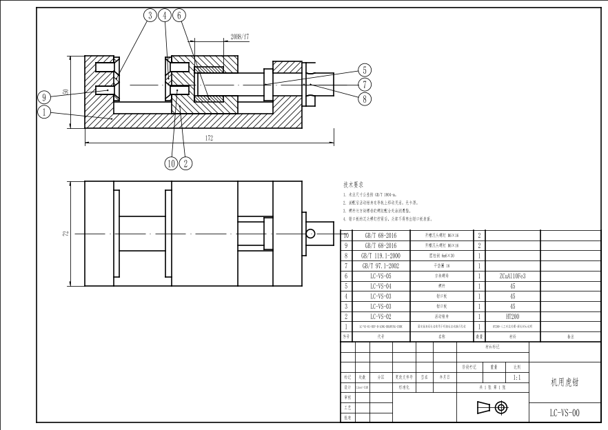
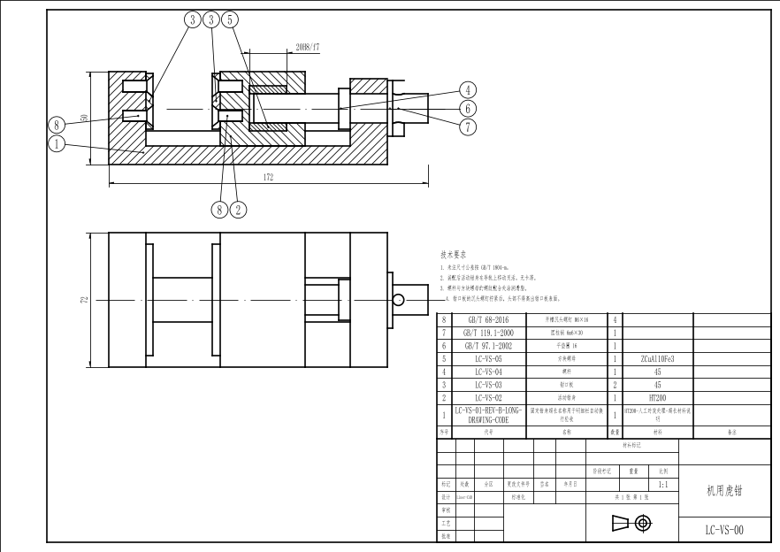

# D5 明细栏：合并相同零件、长文字格内换行

2026-11-22/23 · issue #86 · 分支 `m5/d5-parts-list`（base bdf0d4a）· 热点 assembly.py（`bom_rows / number`）、layout.py（`bom_prims`）

## 改了什么

### 1. 合并相同零件 / 标准件（assembly.py）

- `_part_key(c)` 定义明细栏行身份：
  * 标准件：std 代号 + spec + material（同一标准、同一规格、同一材料合并）。
  * 零件：path + 模型/图纸 hash + `title.drawing_no / name / material`。**实例参数（at/rot、装配位置、左右手、钳口开度等）不参与身份**——同一图号就是同一条明细栏项。
- `bom_rows(d)`：按首次出现顺序合并，`qty` 求和，保留 `ids`（该行对应的组件 id 列表）供序号映射与检查；行号重新编号 1..m。
- `number(d, cid)`：组件 → **合并后**行号；Balloon.number 是属性，合并后自动指向新行。
- 每个组件实例仍各有一个气球（画法要求），合并行中的多个实例**共用同一序号**（示例：vise 两个钳口板都是 #3，两组 GB/T 68 沉头螺钉都是 #8）。

### 2. 序号/气球适配合并后的重复编号（layout.py，D3 计划的兼容修正）

合并后多个气球同号；`_balloon_plan` 由「按 number 作键」改为「按 (index, number, anchor)」，缓存/写死侧/回填都以 index 为准，避免重复编号的气球被挤到同一个圆。L3 A.place 仍 0 违例。

### 3. 长文字格内换行 + 行高自适应（layout.py `bom_prims`）

- BOM 文字统一 GB/T 10609.2 的 3.5 mm 字高（不再为了塞进格子把字高缩到不可读）。
- 每个格子按可用宽度（列宽 − 2×1.2 mm 内边距）逐字符贪心换行，中英文/数字都按字宽断行；标准件代号、名称、材料、备注均可多行。
- 行高 = max(7 mm, 该行各格多行文字总高 + 行距 + 上下内边距)，逐行不同；明细栏整体向上增高，标题栏顶线随之抬高，技术要求仍在其上方排布。
- 每个 Text 图元的外框都落在所属单元格内（含内边距），不越格、不压线；格内多行之间不重叠（测试逐框断言）。

## L3 结果（bdf0d4a → 本分支）

| 装配 | 合并前行/球 | 合并后行/球 | 合并项 |
|---|---|---|---|
| jack | 6 / 6 | 6 / 6 | 无重复（GB/T 71 紧定螺钉单件） |
| vise | 10 / 10 | **8 / 10** | LC-VS-03 钳口板 ×2（plate_fixed/plate_mov）→ qty 2；GB/T 68-2016 M6×16 ×4（csk_fixed/csk_mov 各 2）→ qty 4 |
| bearing | 7 / 7 | 7 / 7 | GB/T 5782 螺栓 qty 2、GB/T 6170 螺母 qty 2（原本就是一个组件多放置） |

vise 气球号示例：合并前 1..10，合并后 `[1,2,3,3,4,5,6,7,8,8]`——每行至少一个气球、所有气球号都是现有行号；重复号是同一明细栏项的多个实例，属预期。

## 评测

命令：`uv run python evals/run.py --level L3`、`--baseline evals/baseline.json`、`evals/place_scores.py --eval40`。

| 项 | main bdf0d4a（D5 前） | 本分支 |
|---|---|---|
| L3 G 族 | 0.998611（1/720：T.bom×C.top.axis） | **1.0（0/720）** |
| L3 D 族 | 0.99（1/100：既有 place_ext_line） | **0.99（同 1 条既有）** |
| L3 A 族 | 1.0（0/116） | **1.0（0/116：align 12 / cross 23 / spacing 81）** |
| 默认 40 例 D 族 | 0.986572（38/2830） | **0.986572（不变）** |
| `run.py --baseline` | — | **`regressions: []`** |
| place_scores jack | D.place 1.0、A.place 1.0（0/25） | **同左** |
| place_scores vise | D.place 0.9583（1/24）、A.place 1.0（0/59） | **同左（D 的 1 条为既有 ext_line，与本卡无关）** |

BOM 行数变少后，原来 T.bom 与 C.top.axis 的 overlap 消失，L3 G 从 1 条既有 warning 变为 0。

## 前后渲染（L3 三装配 + 长文字夹具）

长文字夹具 = 复制 L3 vise，仅把 body_fixed 的 drawing.py title 改成超长名称/图号/材料；渲染前（bdf0d4a）文字被整体缩小塞进一行，渲染后自动换成 2 行、行高增大且仍在格内。

- vise 合并前：　合并后：
  —— 前 10 行（LC-VS-03 两行、GB/T 68 两行）；后 8 行（钳口板 qty2 一行、沉头螺钉 qty4 一行），气球号重复对应合并行。
- jack 前：　后：
- bearing 前：　后：
- 长文字换行前：　后：
  —— 前：超长图号/材料被缩成一行小字；后：图号与材料各换 2 行，行高自适应，文字全部留在格内。

## 回归用例（G2 首个 commit 3faf96f，实现 commit 28c0b60）

`tests/test_assembly.py`：
- `test_bom_merges_identical_components`：相同 bush（同名不同实例名）合并 qty2，5 个气球号 `[1,2,2,3,4]`。
- `test_bom_merges_identical_standard_parts`：两个 GB/T 97.1-2002 6 合并 qty3，气球号 `[1,2,3,4,4]`。
- `test_l3_vise_bom_merges_jaw_plates_and_screws`：LC-VS-03 仅 1 行 qty2（plate_fixed/plate_mov）、GB/T 68-2016 qty4（csk_fixed/csk_mov）。
- `test_l3_assembly_case`（更新为新语义）：行数 ≥4、每个组件一个气球、每个行号至少一个气球、所有气球号 ∈ 行号；BOM 文字框不越过表格边界。
- 既有 `test_bom_rows_and_balloons` 等无重复件的语义不变（回归不削弱）。

`tests/test_bom_wrap.py`（新）：
- `test_long_cell_text_wraps_inside_its_cell[cjk / latin]`：长名称/材料使行高 > 2×BOM_ROW；每个 Text 框落在所属列的左右边界、所属行的上下边界内；同一格多行、行间不重叠。

## 说明 / 残余

- 合并身份按「同一图号 = 同一明细栏项」；同一图号但实例参数不同（如 vise 钳口板左右手）会合并为一行，这是 BOM 惯例，但会丢失参数差异信息（模型里仍保留在组件上）。
- 换行按字符贪心，不做英文连字符/单词整体换行；中文为主场景足够。极长单元格会让该行和明细栏继续向上长（不溢出格子），若超过图幅空间应由后续排版兜底（本卡 L3/夹具均在 A3 内）。
- `scripts/release.py` 的 ruff format 问题是 main 既有，不在本卡改动；CI lint 只跑 ruff check。

## 门禁（最终数字见 PR/CI）

- 全量 `uv run pytest -q`：**1399 passed / 1 skipped（11m18s）**；`uv run ruff check .` 绿；`ruff format --check src tests` 绿（97 files）；L3 与 --baseline 见上；CI 四项绿后由 lead 合并。
