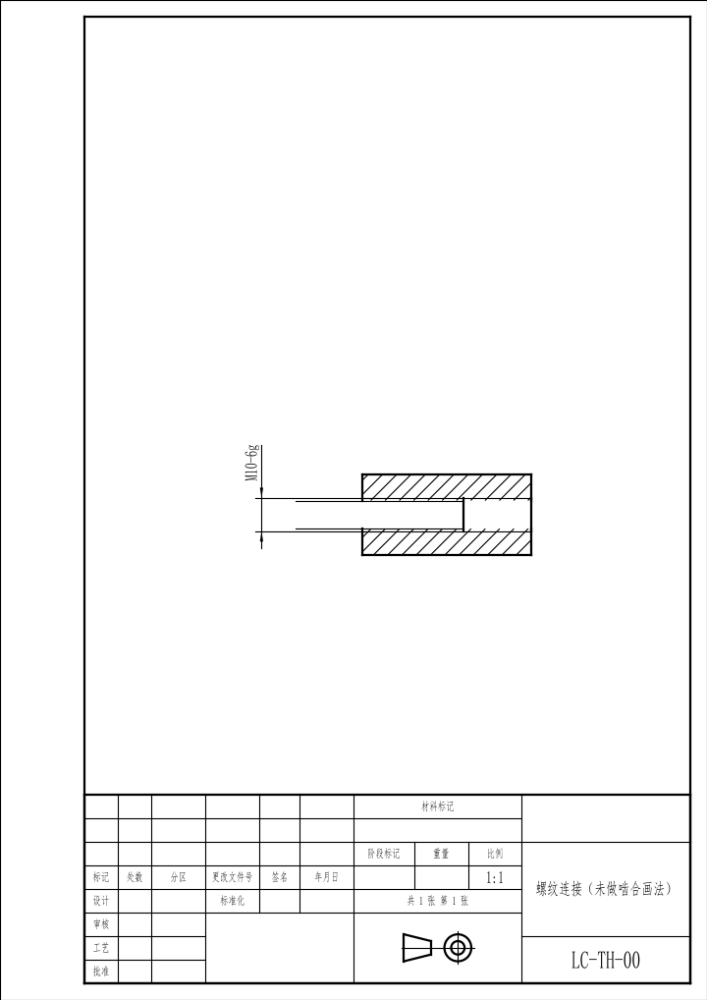
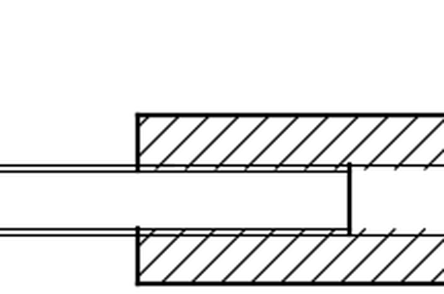
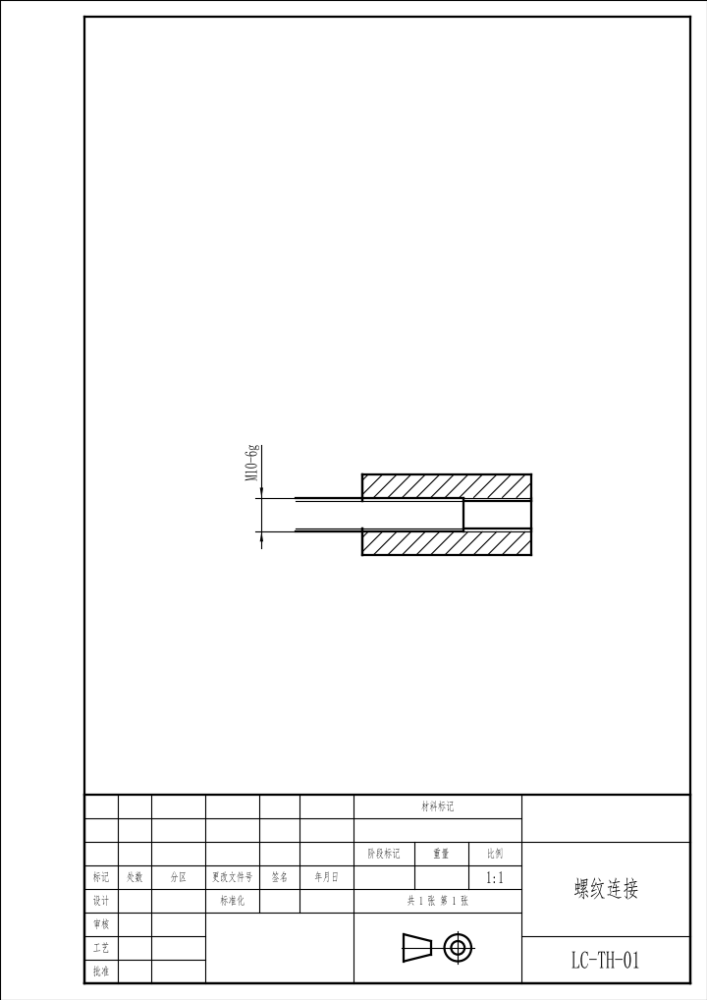
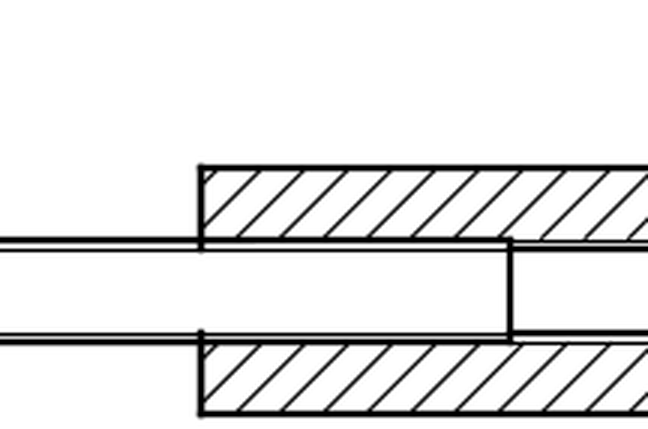

# D6 装配螺纹啮合画法（GB/T 4459.1）

2026-11-23 · issue #88 · 分支 `m5/d6-thread-meshing`（base 6673acf）· 热点 features.py + assembly.py

**条款号状态（pending，不编造）**：资源库 `res/catalog.toml` 的 `conv_dim` 只写到标准系列
`GB/T 4459.1-1995 / 4459.3-2000 / …`，没有本画法对应的具体条款号；GB/T 4459.1 原文未在
本轮取得，所以 evidence 不写虚构条款号，实现按标准通行画法表述（见下）。

## 改了什么

### 1. 内核工具 `v.thread_mesh(...)`（features.py）

调用：

```python
v.thread_mesh("joint", "M10", screw=(0, 50), hole=(20, 70), outer=12,
              axis=0, cls_ext="6g", cls_int="6H")
```

- `screw=(x0,x1)`：外螺纹（螺钉）轴向范围；`hole=(x0,x1)`：螺孔（螺母/被连接件）轴向范围；
  两者**轴向交集即旋合长度**（由 `assembly.thread_engagement` 判定；无交集报错并给候选）。
- **旋合段按外螺纹画**：大径粗实线、小径细实线；这段不再重复画内螺纹的小径粗线/大径细线。
- **未旋合段按各自画法**：外螺纹未旋合段大径粗/小径细；内螺纹未旋合段小径粗/大径细，
  并画内螺纹终止线。
- **孔端面线只画到螺纹小径**：`outer` 给出被连接件外半径时，螺孔入口端面线从螺纹小径画到外轮廓。
- 全部规定画法线带 `conv` 标签；`spec/d/P/d1/d2/coarse/std/screw/hole/engaged/axis/outer/cls*` 都进
  feature intent，`v.dim.thread(...)` 可直接对 `thread_mesh` 特征注 `M10-6g`（已接入 annotate/rules）。

### 2. 装配语义（assembly.py）

- `thread_engagement(screw, hole)`：旋合长度 = 两轴向区间的交集；不重叠时 `InvalidArgument`，
  values 给两个区间，candidates 提示检查螺纹长度/螺孔深度。
- `thread_hatch_loops(spec, screw, hole, outer, axis=0)`：被连接件剖视剖面线的两个闭环（轴上/下），
  内边界在**外螺纹牙顶（大径 d/2）**，不是内螺纹小径；交给 `v.hatch(...)` 使用，外形轮廓由调用方画。

### 3. 公共文档

- `src/linercad/skill/pages/api.md` 增 `v.thread_mesh` 行；`skill/pages/assembly.md` 增装配剖面
  啮合与 `thread_hatch_loops` 用法。

## 前后对比（渲染图元）

测试夹具：`Drawing(kind="assembly", sheet="A4")`，螺母外形 20..70、外半径 12；螺钉螺纹 0..50，
螺孔 20..70，M10（d=10, d1≈8.376）。

| 项 | before（main 6673acf 的旧画法） | after（本分支） |
|---|---|---|
| 旋合段 20..50 | 外螺纹 + 内螺纹两套线同时出现（小径处粗细线重叠） | **只按外螺纹**：大径粗、小径细 |
| 孔入口端面线 | 无 | **从螺纹小径 d1/2 画到外轮廓** |
| 未旋合内螺纹 50..70 | 内螺纹线 | 内螺纹小径粗、大径细 + 终止线 |
| 剖面线内边界 | 画到内螺纹小径（d1/2≈4.188） | **画到外螺纹牙顶（d/2=5）** |
| 螺纹代号 | — | `M10-6g`（`v.dim.thread`） |

渲染（A4 整页 + 中央局部放大）：

- before：　局部：
- after：　局部：

## 回归用例（G2 首 commit 6de2e52；`tests/test_thread_mesh.py` 6 条）

- `test_engaged_region_is_drawn_as_external_thread`（G2 失败项）：自由外螺纹段、旋合段、未旋合
  内螺纹段分别断线型/半径；旋合段没有重复内螺纹线。
- `test_hole_end_face_line_stops_at_the_minor_diameter`（G2）：孔入口端面线内端 = d1/2，外端 = outer。
- `test_engagement_is_the_axial_overlap_of_screw_and_hole`：交集计算；无重叠 `InvalidArgument` + candidates。
- `test_hatch_loops_reach_the_external_thread_major_diameter`（G2）：hatch 内边界 = d/2、外边界 = outer。
- `test_thread_mesh_rejects_a_missing_engagement`（G2）：无旋合报错。
- `test_assembly_thread_connection_builds_and_draws_the_joint`：真正建装配临时图纸仓库，
  断言 `F.front.joint` 旋合区间、每个 feature edge 有渲染图元、`H.front.nut` 剖面线存在且
  内边界 = 5 mm；同时 `v.dim.thread` 注代号、构建零 error。

## Codex R1 回应

- **blocker（已修）**：`View.thread_mesh` 是 mutator，但没进 `record.CREATE_OPS / VIEW_SCOPED`，录制会丢 `F.*` id、
  replay 报 StaleOp。已加入两表；`tests/test_record.py::test_thread_mesh_records_its_feature_id_and_replays`
  回归（record op id = F.front.joint，replay 无 stale）。
- **major（已修）**：`dim.hole` 被允许接受 thread_mesh 但没有 points，会 KeyError；已从 dim.hole 类型清单移除，
  螺纹代号统一走 `dim.thread`（对 thread_mesh 已验证）。
- **major（不采纳并说明依据）**：Codex 建议未旋合内螺纹段的剖面线内边界退回小径 d1/2。按 GB/T 4459.1 通行画法，
  内螺纹剖视的剖面线画到**大径（牙底，细实线）**，因此未旋合段与旋合段的 hatch 内边界都在 d/2（本实现 `rroot =
  max(d/2, d1/2+GAP)`，M10 时恰为 5.0）；画到 d1/2 会把螺纹牙型的材料留在剖面线外，不符合标准画法。已保留并在
  测试/证据中锁定 d/2。
- **major（已修）**：原集成夹具在 x=20/70 画了贯穿螺孔的整条端面线，与 thread_mesh 的短端面线重叠，导致 after
  证据不能证明“端面线只到小径”。已把调用方外形线拆成上下两段（±12 到 ±d1/2），并重新渲染；集成测试新增
  渲染图元断言：feature edge 的 Line 坐标与 intent 一致、hatch 的 Hatch prim loops 内边界 5 mm / 外边界 12 mm。
- **minor（已修）**：`outer` 校验统一为 > 外螺纹大径半径 d/2；`thread_hatch_loops` 的 hole 参数改为严格两元组校验，
  非法输入返回 InvalidArgument（不再裸 TypeError）。
- **minor（已修）**：移除 `thread_mesh` 未使用的 `cut` 参数（工具面向装配剖视；非剖视虚线不在本卡范围）。
- **剩余 minor**：单元测试仍主要断言生成的 intent；集成测试已补渲染 prim 断言，但 hatch 实际填充图案由渲染器生成，
  测试只验证 Hatch prim 的边界环；这属于现有测试设施边界。

## 评测 / 门禁

- 40 例评测 **40/40、geometry 1.0**，20 条 expect 198 checks 全过；默认 D 族 0.986906（E3 后 baseline 同值），
  `--baseline` **regressions: []**。
- L3 三装配零 error：G 1.0、D 0.99（既有 1 条 ext_line）、A 1.0（0/116），与 main 一致（L3 没改）。
- 全量 `uv run pytest -q`（R1 修正 + merge E4 后）：**1496 passed / 1 skipped（12m00s）**；`uv run ruff check .` 绿；`ruff format --check src tests` 绿；CI 四项待跑/绿。

## 残余

- `screw`/`hole`/`outer` 由调用方给出：3D 装配模型按大径光圆柱简化，内核还没有从组件几何自动
  推断旋合范围（本卡提供装配语义的区间判定与画法，不自动识别 3D 螺纹）。
- 本卡没有把 L3 三例改成 `thread_mesh`（避免改变已验收的 L3 几何/评分）；`thread_mesh` 已作为
  内核工具供后续装配图使用。
- 工具面向装配**剖视**；非剖视（虚线）画法不在本卡范围。
- 未旋合内螺纹只覆盖从螺孔入口到旋合起点、以及旋合终点到螺纹底部两段；盲孔钻尖等由调用方画。
- GB/T 4459.1 具体条款号 pending（见文首），未编造。