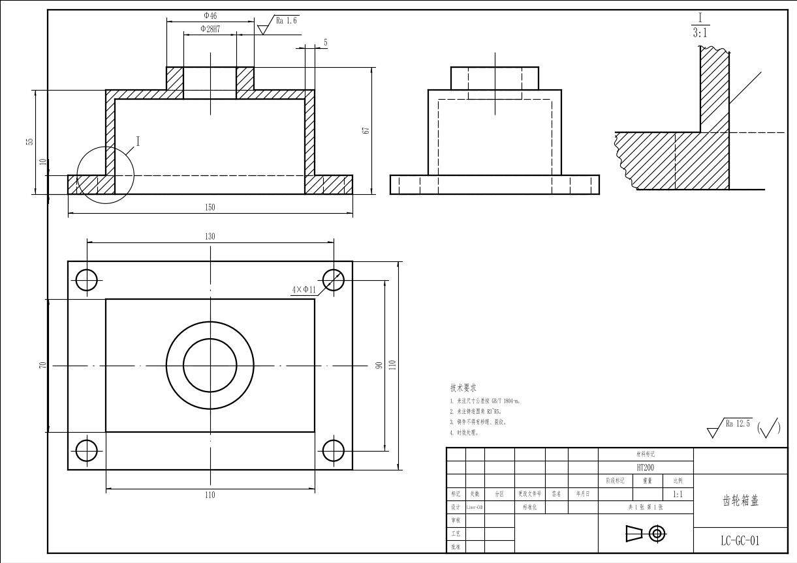
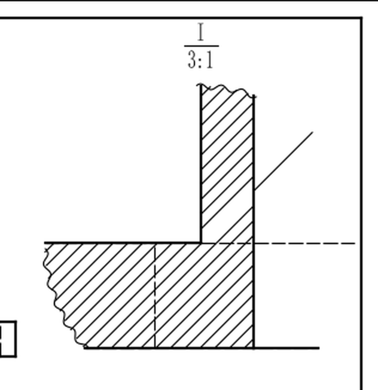
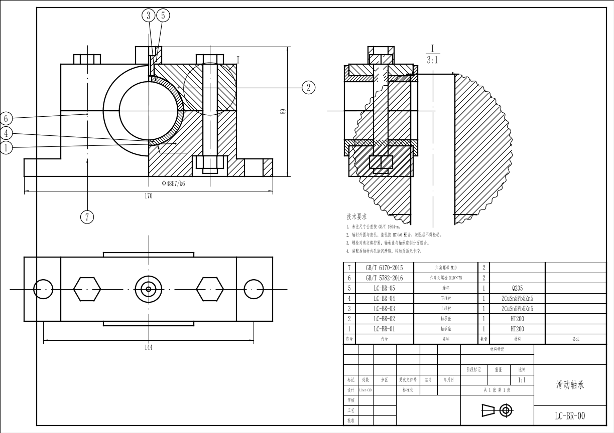
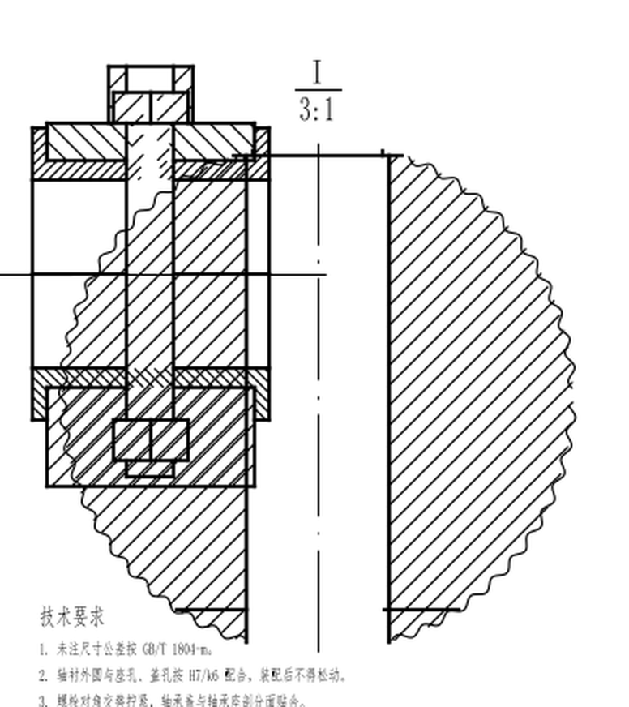

# D7 3D 投影视图与装配视图的局部放大

2026-11-23 · issue #89 · 分支 `m5/d7-detail-views`（base 48d119b）· 热点 views.py / layout.py（源语义与裁剪）

## 改了什么

局部放大的既有机制（`d.detail` + `V.<letter>` 裁剪重画 + 细实线圆/波浪边/`I` 与比例标注）
对 2D 视图已经可用；本卡把它接到 3D 投影与装配视图上，并补上**源语义回溯**和装配剖面线样式：

- **源语义回溯**：`detail_geometry` 为每个裁剪图元记录来源元素，写入 `V.<letter>._intent["detail_sources"]`
  （`id / kind / feature / prims` 索引）。新增 `views.detail_sources(d, letter)` 与
  `d.q.detail_sources(letter)`：返回放大图覆盖的父视图边、中心线、剖面线元素。3D 投影边的
  `src3d`（D4 的拓扑命名）随源边保留，选择放大图内容可回溯到源视图/源特征；局部放大图本身仍是
  `V.<letter>` 拥有的图元（SPEC M1 §5 的 bbox/选取约定不变）。
- **装配剖面线样式**：局部放大重新生成剖面线时使用父层 hatch 自己的 `angle` / `spacing`（此前一律
  用 std 默认 45°），装配图不同零件的剖面线方向在放大图中保持一致；hatch 仍按图纸间距重新生成。
- 3D 投影/装配父视图的边、中心线、剖面线都走同一裁剪/缩放路径；圆圈裁剪、材料内波浪边、
  `I / 3:1` 标注复用既有实现。

## 前后行为（装配 bearing，front 视图 center=(42,15), r=18, 3:1）

| 项 | main 48d119b | 本分支 |
|---|---|---|
| 放大图图元 | 82 | 82（几何不变） |
| 剖面线角度 | **全部 45°**（61 条） | **45° 8 条 + 135° 53 条**（按父组件 hatch 方向） |
| 源语义查询 | `d.q.detail_sources` 不存在 | **17 个来源**：14 条带着 `src3d` 的投影边、3 个组件；剖面线 2 个 |
| 3D 投影 gear_cover detail | 只能得到匿名图元 | **48 图元 / 12 源元素 / 1 剖面线源**，可回溯 `E.front.*` + `src3d` |

## 几何/标注核对

- 裁剪缩放与既有 2D 局部放大共用 `clip_segment / clip_arc / hatch_lines`，所有 thick/hatch 图元
  落在放大圆 `r*scale` 内（`tests/test_views.py::test_detail_view_clips_scales_and_labels` 及本卡测试）。
- 放大图标注 `I` + `3:1`（GB/T 4458.1 字母/短横线/比例），父视图 `S.I` 细实线圆 + 字母；既有测试覆盖。
- 装配 bearing 的 detail 有 14 条源投影边、3 个组件，`src3d` 引用可回源；gear_cover detail 覆盖
  剖面/孔边等 12 个源元素。

## 前后渲染（整页 + 局部）

- gear_cover（3D 箱盖，detail I 3:1，front(-55,10) r15）：
  前：　后：
  局部：　
- bearing（L3 装配，detail I 3:1，front(42,15) r18）：
  前：　后：
  局部：　

装配前后最明显的差别是放大图剖面线方向：前全部 45°，后 135°/45° 与父组件一致；另外 after 的
`d.q.detail_sources("I")` 能列出源边/组件（渲染图元本身形状不变）。

## 回归用例

- `tests/test_detail_semantics.py`：`detail_sources` 可查询且指回父边；detail 剖面线保留父 hatch 的
  角度/间距（G2 失败项：D7 前没有 query API，且 hatch 全部 45°）。
- `tests/test_views_detail3d.py`：3D 投影 detail 的源边带 `src3d`、`V.I.detail_sources` 非空；
  gear_cover detail 与 L3 bearing 装配 detail 都能 build、源查询含组件/剖面线（G2 失败项）。
- 既有 `tests/test_views.py` 局部放大裁剪/缩放/波浪边/标注/剖面线重生成全部通过。

## 说明 / 残余

- 局部放大图图元仍归 `V.<letter>` 所有（不改变 SPEC M1 §5 的 bbox/选取约定）；源回溯通过
  `detail_sources` 元数据与 `d.q.detail_sources()` 提供，而不是把裁剪边拆成独立元素。
- `source3d.py` 未改：3D 投影边在父视图里已经带稳定 `src3d`（D4），本卡通过源边引用保留它；
  没有新增投影算法。
- 父视图/放大图的自动摆放沿用既有 layout；本卡证据选的 detail 区域均在图框内。
- 本卡不新增 L3 用例（避免改变 L3 评分）；gear_cover/bearing 用临时图纸仓库验证。

## 门禁（最终数字见 PR/CI）

- 全量 pytest / ruff check / format --check src tests；40 例评测、`--baseline`、L3 不变；CI 四项。