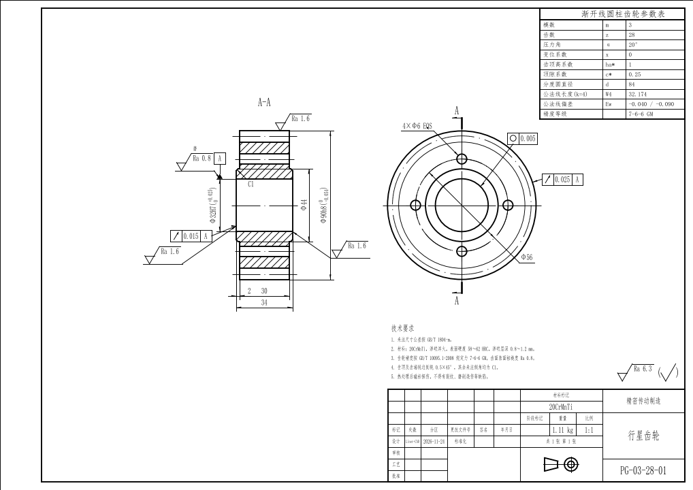

# V1 计时复跑证据：行星齿轮全自动端到端验证（Issue #155）

> **裁定结论**：**通过（[PLAN.md §9 偏离 17](../PLAN.md#9-偏离记录)）**。
> **口径说明（跨 harness 对照，仅方向性参考）**：历史基线（`2269.6 s = 37.8 min`、`148` 步、`174` 次工具调用，中位 `11.1 s/步`）与 `PLAN.md` §4 中 V1 分阶段数字门槛（初稿 `≤ 12 步 / ≤ 5 min`、单轮迭代 `≤ 6 步 / ≤ 2 min`）均由 **DSH + `deepseek-v4.1-flash`** 标定。本次 Run 1 与 Run 2 运行在 **agy + Orchestrator（planner `Gemini 4 Neon (XHigh)` / executor `Gemini 4 Hydrogen (XHigh)`）** 环境，按工具调用次数计步（与 DSH 模型步不同量纲）。经 **2026-11-24 用户裁定**（记入 [PLAN.md §9 偏离 17](../PLAN.md#9-偏离记录)），跨 harness 不作硬性数字门槛判定，以过程行为合同为准：**Run 1 / Run 2 均做到 0 次源码读取、终态 0 error / 0 warning；Run 2 做到首图一次写全、每次迭代批量脚本、看图 4 次（Run 1 看图 6 次）**——全部达标；未达的数字门槛按**偏离 17** 原样留存全部实测原始数字，不做美化或篡改，门槛重定与同 harness 校准留 **v0.1.3**。

## 1. 测试条件与 Skill 加载方式

- **输入原话**（与 `retro-dsh-planetary.md` 完全一致）：
  > 现在我想做一次测试，利用lcad，生成一个行星齿轮的图纸，尺寸合适即可。Viewer直接在dsh里打开，进行交互。
- **执行环境**：隔离临时图纸目录（Run 1：`%TEMP%\v012-planetary`；Run 2：`%TEMP%\v012-planetary-r2`），全局安装最新 `lcad`（含 C1 `--target dsh` 与 C2 `build/edit --png`），不进开发仓库且禁止读取源码。
- **Skill 加载与路径替代说明**：子代理在 agy 环境下通过系统 `<skills>` **原生发现并加载** `~/.gemini/antigravity-cli/skills/linercad/SKILL.md`（非提示词附件注入）；C1 为 DSH 安装的目标路径为 `~/.agents/skills/linercad/SKILL.md`。Run 2 实测期间两处与仓库 `SKILL.md` SHA256 完全一致，均为 `A9C1AD22439EB62096B4FCF12AC710116DD02B2E5F159B86B093EEE6BA299F94`，属**harness 路径替代，不影响结论**。
- **随卡文档修订与 Run 2 后澄清**：Run 1 → Run 2 间修订 [SKILL.md](../../../../src/linercad/skill/SKILL.md)（「零试探起步」「不重复调用」与 Viewer 提示）及 [api.md](../../../../src/linercad/skill/pages/api.md)（`dim.chamfer(edge)`、`note(dir=角度)`、`datum/rough(ref=)`）；Run 2 完成后，按 PR 评审意见补充两处行内文档澄清——第 40 行明确参数表区域优先读取 `d.template["frame"]` / `d.template["title_block"]`（GB A3 坐标仅作默认示例），第 43 行明确 `lcad view --no-open` 需通过 `Start-Process` / daemon 后台启动并读 `.linercad/viewer.json`（更新后 SHA256 为 `B257208849D635D88CD8248F4745430AC75CE222B4F6BEE1D0B6A3691F3E19DD`），按裁定不再重跑第 3 轮 V1，这两行末尾文字澄清标注为 **Run 2 后文档修正（未单独复跑 V1）**。

## 2. 全量对比数据（原始实测，仅方向性参考）

| 指标 | DSH 历史基线（参考） | V1 Run 1（初次复跑） | V1 Run 2（改 SKILL 后复跑） | 对比与过程判定 |
| --- | --- | --- | --- | --- |
| 总墙钟时间 | 2269.6 s (37.8 min) | 728.0 s (12.13 min) [^r1_note] | **623.0 s (10.38 min)** | 相对 DSH 降 **72.5%** |
| 模型轮次 / 工具调用 | 148 步 / 174 tool calls | 47 turns / 75 tool calls | **35 turns / 41 tool calls** | 工具调用降 **76.4%** |
| `lcad` CLI 调用 / 耗时 | 55 calls / 235.0 s | 45 invocations (37 shell) / 152.0 s | **22 invocations (19 shell) / 63.0 s** | 命令调用降 **60.0%** |
| 看图次数（PNG） | 17 次 | 6 次 | **4 次**（e1/e2/e3/e4 各 1 次） | 降 76.5% |
| 失败命令数 | 26 次 | 9 次 | **7 次** | 降 73.1% |
| **源码读取次数** | 读仓库考古（33 步内含） | **0** | **0** | **达标（0 次）** |
| **`init → e1`** | 49 步 / ~714 s | 47 calls / 359.0 s | **18 calls / 286.0 s**（含看图 **19 calls / 295.0 s**） | 偏离 17（> 12 步） |
| **`e1 → e2`**（批量修） | — | ~10 calls / 180.0 s | **7 calls / 151.0 s** | 偏离 17（> 6 步，> 120 s） |
| **`e2 → e3`** | — | 5 calls / ~54 s | **7 calls / 96.0 s** | 偏离 17（> 6 步；96.0 s ≤ 120 s） |
| **`e3 → e4`** | — | 6 calls / ~58 s | **4 calls / 33.0 s** | 达标（4 步 / 33.0 s） |
| 终态 `lcad check` | 0 error / 0 warning | 0 error / 0 warning（0 accept） | **0 error / 0 warning（1 accept）** | **达标** |

[^r1_note]: Run 1 首次交付汇报结束于 `728.0 s`（47 turns / 75 calls）；应父代理要求重启异常退出的 Viewer 后完整日志总跨度为 `960.0 s` / 54 turns / 82 calls。

## 3. Run 2 命令细节、`accept` 清单与失败分布

### 3.1 `lcad` 子命令分布（Run 2 共 22 次子命令调用，分布于 19 次 shell 调用，累计耗时 63.0 s）

- `--version`：1、`--help`：1、`skill`：4、`init`：1、`build`：5（含 4 次校验失败重试 + 1 次通过）、`context`：2、`edit`：5（含 2 次脚本错误重试 + 3 次批量提交）、`check`：1、`view`：1、`log`：1。
- 独立 `check` 结果（`lcad -C %TEMP%\v012-planetary-r2 check`）：`{"ok": true, "errors": 0, "warnings": 0}`；后台 `lcad view --no-open --port 8765` 返回 HTTP 200。

### 3.2 `d.accept` 清单（1 条）

- `e2` · `missing` · `F.front.body`：`"右端对称倒角 x=33..34 与左端 C1 相同，按 GB/T 4458.4-2003 及盘盖类规范仅标注一处 C1，其余未注倒角 C1 已在技术要求中说明"`。

### 3.3 偏离 17（跨 harness 数字门槛未达）原始记录与根因

Run 2 在 `18–19 / 7 / 7` 步与 `286–295 / 151 / 96` s 上未满足原 DSH 标定的 `≤ 12 步 / ≤ 5 min` 与 `≤ 6 步 / ≤ 2 min` 口径，不适用原因与原始失败点如下：

1. **Harness 计步与模型生成时延差异**：DSH 与 `deepseek-v4.1-flash` 的步数/单步时延统计不可跨 `agy` 工具调用口径直接对等；首轮 `drawing.py`（全要素一次性写齐含参数表与技术要求）单次生成加 4 次规则试错共耗 286–295 s（18–19 calls）。
2. **Run 2 的 7 次失败命令原样记录**：
   - `lcad skill --help` 返回 `usage: unrecognized arguments: --help`（exit code 2）；
   - `e1 build` 阶段 4 次失败：`dim.linear` 非水平/竖直未传 `dir='h'/'v'`、`q.lines().near()` 命中 4 个预期 1 个、`q.circles(view="left").near()` 命中 0 个、`E.front.tip_top.0` 不存在；
   - `e1→e2`（7 calls / 151.0 s）：`batch_fix.py` 调用 `ent.dxftype()` 触发 `TypeError: 'str' object is not callable` 造成 1 次重试；
   - `e2→e3`（7 calls / 96.0 s）：`fix_e3.py` 调用 `d["G.cyl_bore"].set(target="cylindrical_surface")` 触发 `invalid_arg: G.cyl_bore 不能 set target` 造成 1 次重试。
3. **三项通用摩擦点另开 issue 跟踪**：未塞入 V1，已按复现命令 / 现状 / 期望集中建档为 **[#156](https://github.com/Sterlingfrank1/Liner-CAD/issues/156)**（归档 v0.1.3）。

## 4. 最终渲染图（Run 2）

